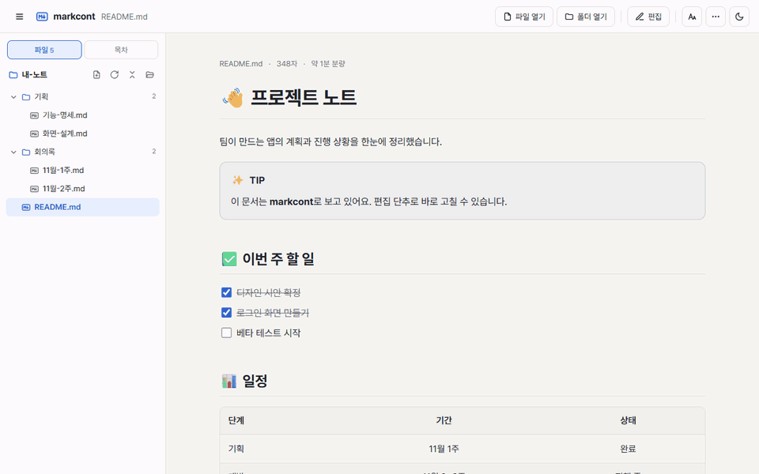

[한국어](README.md) | **English**

<div align="center">


# markcont

**A viewer that shows Markdown nicely and lets you edit it right where you read it**<br>
Web · Windows · macOS · Linux

[**🌐 Use it now, no install**](https://ryuseojin.github.io/markcont/) &nbsp;·&nbsp;
[**📥 Download**](https://github.com/RyuSeoJin/markcont/releases/latest) &nbsp;·&nbsp;
[**📘 User guide**](app/docs/guide.en.md)



</div>

## ⚡ In 3 seconds

- 📖 **View** — `.md` files in GitHub style: callouts, tables, task lists, code highlighting, math · chemical formulas, and even diagrams
- ✏️ **Edit** — source and result side by side, a preview that updates as you type · saving writes straight to the original file
- 📁 **Organize** — open a whole folder as a tree, and create · rename · delete documents, all on one screen

## 📥 Install (one line)

**Windows** — paste into PowerShell

```powershell
irm https://raw.githubusercontent.com/RyuSeoJin/markcont/main/install.ps1 | iex
```

**macOS · Linux** — paste into a terminal

```bash
curl -fsSL https://raw.githubusercontent.com/RyuSeoJin/markcont/main/install.sh | sh
```

**No install** — open https://ryuseojin.github.io/markcont/ (you can use it like an app with **Add to Home Screen** on a phone, or the **Install** button in the address bar on a PC)

> [!TIP]
> Files are read only on your own device. Nothing is uploaded anywhere.

---

## 📦 Direct download

| Platform | File ([Releases](https://github.com/RyuSeoJin/markcont/releases/latest)) |
|:---|:---|
| 🪟 Windows | The file ending in `-setup.exe` |
| 🍎 macOS | `.dmg` (works on both Intel · Apple chips) |
| 🐧 Linux | `.AppImage` · `.deb` · `.rpm` |

> [!NOTE]
> There's no code-signing certificate, so you may see a warning the first time you run it.
> On Windows, click **More info → Run anyway**; on macOS, **right-click** the app **→ Open**.

---

## ✨ Features

- GitHub-style display, dark mode, text size · font · body width settings
- 11 kinds of callouts `> [!NOTE]` (foldable), tables, task lists (click to check), footnotes, highlight `==text==`
- Bold · italic that works with Korean, Chinese and Japanese: `**스크립트(script)**는` stays bold even when a character follows a bracket or punctuation
- Suggestion marks `{++add++}` · `{--cut--}` · `{~~old~>new~~}` · `{>>comment<<}`: click to accept or reject each one (Claude suggestion mode)
- `:::` blocks: tabs (tabs with the same name switch together and are remembered) · steps (numbered circles) · file tree (folder · file icons)
- Code highlighting · line numbers · copy · enlarge, `diff` coloring
- Math `$E=mc^2$`, chemical formulas `$\ce{H2O}$`, diagrams: markcont style (markcont-standard flowcharts, message order, state changes, timelines, exposure trees with entry points) and Mermaid, plus workflow writing rules for large flows
- Wikilinks `[[document#heading]]`, link · footnote previews (hover or long-press), video · YouTube thumbnails
- Embed documents `![[doc#heading]]`: shows another document (or its heading section) right there (keep shared rules · glossaries in one place)
- Images: click to enlarge (zoom · pan), a description under images that sit on their own line, and sizes with `` · `![[image.png|300]]`
- Quick open · commands <kbd>Ctrl</kbd>+<kbd>O</kbd>: find files by name or initials (`fp` → feature-proposals, Korean initial consonants `ㄱㅎㅅ` → 기획서), commands with `>`, headings with `#` (accents, full-width letters and kana are matched too)
- A workspace that opens several folders together, folder tree · file search · right-click menu, table of contents, heading folding, find in document, focus mode
- Search all documents <kbd>Ctrl</kbd>+<kbd>Shift</kbd>+<kbd>F</kbd>: searches every open folder, groups matches by document and jumps to the line (match case · whole word · regex, Korean initial consonants)
- Links tab: what links here (backlinks) · what this links to · broken links (including links that open only in markcont); renaming a file · folder · heading also fixes the links that pointed to it
- A table of contents inside the text with `[[_TOC_]]` (also in print · PDF), and heading numbers (1 · 1.1 · 1.1.1) shown without changing the source
- Live editing: source with line numbers and syntax colors, a marker for where you're editing, scroll sync
- Editor basics: find and replace <kbd>Ctrl</kbd>+<kbd>H</kbd> (match case · whole word · regex), move lines <kbd>Alt</kbd>+<kbd>↑</kbd><kbd>↓</kbd>, raise · lower heading levels, renumber numbered lists
- Table editing: move between cells with <kbd>Tab</kbd>, align columns (measuring Korean character widths), add · delete · move rows and columns, sort by a column
- Paste as markdown: screenshots become image files in an `images` folder next to the document, Excel cells become tables, text from the web · Notion · Google Docs · Word keeps its headings · lists · links, and a URL pasted over selected text becomes a link
- Saved versions that survive closing: a copy is kept on every save and every time Claude or another program edits the file, so you can go back for 14 days
- Auto-reload of changed files, Save as HTML, Print · PDF
- Save for other viewers: a copy with markcont-only syntax converted to standard markdown (diagrams to Mermaid), plus a marker for spots that look different
- Document check: broken links · images, skipped heading levels, footnotes, table rows with a different cell count, long sentences and writing rules in one list
- A first-run tour (tutorial) that walks you through the features
- PC app: connect to Claude Desktop · Claude Code over MCP to edit documents in your open folders, with highlighting and undo for changes made from outside

How to write documents that look good is in the [Markdown writing rules](app/docs/writing-rules.en.md), and how to use the app is in the [User guide](app/docs/guide.en.md).

---

## 🔌 Connect to Claude (PC app)

The PC app also works as an **MCP server**. Ask Claude Desktop · Claude Code something like "Polish the document I'm viewing in markcont," and Claude edits the document in the folder you have open in markcont, and the changes show up in markcont **right away**.

1. In markcont, open the folder you want to work in with **Open folder**.
2. In **⋯ → Connect to Claude (MCP)**, press **Connect to Claude Desktop**, or copy the Claude Code command and run it.
3. Restart the Claude app and make your request. You chat **in the Claude app** with your own Claude subscription; markcont doesn't use a subscription or an API key.

- Claude can read and edit **only Markdown · text files inside the folders you have open**. It can't delete, rename, or run commands.
- Turn on **Only suggest changes** and Claude leaves suggestion marks (`{~~old~>new~~}`) instead of changing the text; you accept or reject each one in markcont.
- Changes are highlighted in markcont, and you can review them with **View changes · Undo**.
- If something gets changed by mistake, you can undo it with **View changes · Undo history**, and even after it has been saved to the file you can go back to the content before the edit in **Saved versions** (14 days, up to 50 per file). Still, keep backups of important documents.

## 🔒 Privacy

- markcont reads and writes documents **only on your own device**. It doesn't collect usage data (telemetry) either.
- If you use **Connect to Claude**, the content of documents Claude reads is sent to Anthropic for processing (Anthropic's terms · privacy policy apply). If you don't connect, nothing is sent.
- The web app's settings · recent documents stay only in your browser's storage.
- Saved versions (copies of a document kept on every save or outside change, 14 days, up to 50 per file) stay only in the app's settings folder for the PC app and in browser storage for the web app. You can remove them with **History → Saved versions → Delete these versions**.
- It works without the internet, but in the cases below it connects to an external server, and **your IP address is sent to that server**.
  - When you choose the **Serif** font in View settings: the font is downloaded from Google Fonts.
  - When a document has a **YouTube link**: the thumbnail is downloaded from YouTube (Google) servers.
  - When you open a file made with **Save as HTML**: font · math · code highlighting styles are downloaded from CDNs (jsDelivr · cdnjs).
  - When showing **web images** in a document: they're downloaded from the server hosting them.

> Claude is a trademark of Anthropic. markcont is an independent open-source program not affiliated with Anthropic.

---

## 🛠️ How it's built (for developers)

```
app/                Interface (shared by the web app and the PC app)
  index.html        The whole viewer
  sw.js             Offline storage
  docs/             User guide, writing rules, feature examples (also open inside the app)
  vendor/           Conversion libraries (work without the internet)
src-tauri/          PC app (Tauri 2)
.github/workflows/  Deploy the web app, build the PC app
install.ps1 / .sh   One-line install scripts
```

- **Web app**: Pushing to the `main` branch publishes it to GitHub Pages automatically.
- **PC app**: Pushing a tag like `v1.0.0` builds the installers and uploads them to Releases.
  When releasing a new version, bump the version in `src-tauri/tauri.conf.json`, `src-tauri/Cargo.toml`, `package.json`, `VERSION` in `app/sw.js`, and `APP_VERSION` in `app/index.html` together.
- To build on your own PC, install [Node.js](https://nodejs.org) and [Rust](https://rustup.rs), then run `npm install`, `npm run icons`, `npm run build`.

## 📄 License

[MIT](LICENSE) © 2026 RyuSeoJin

Licenses for the included libraries are in [Open-source licenses](app/docs/licenses.en.md) and `app/vendor/licenses/`. The list of libraries in the PC app is added automatically when the installers are built, and you can see it in the app under **⋯ → Open-source licenses**.
