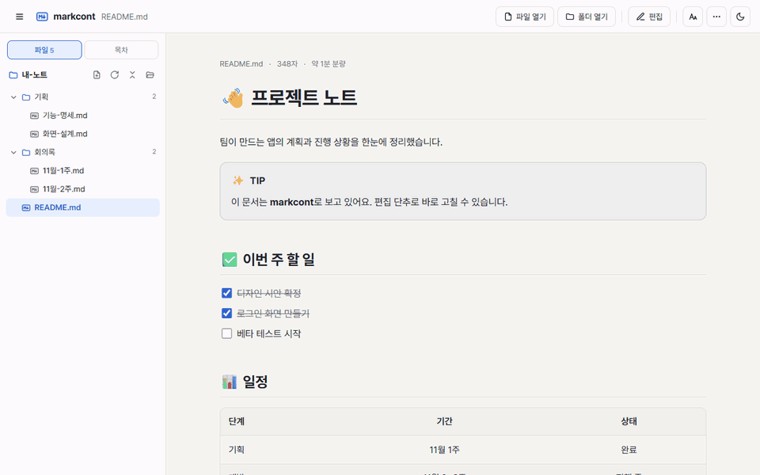

[**한국어**](README.md) | [English](README.en.md)

<div align="center">


# markcont

마크다운을 읽기 좋은 문서로 보여 주고, 보던 자리에서 바로 고칠 수 있는 뷰어입니다.<br>
웹 앱과 Windows · macOS · Linux 프로그램으로 쓸 수 있습니다.

[웹에서 바로 쓰기](https://ryuseojin.github.io/markcont/) · [내려받기](https://github.com/RyuSeoJin/markcont/releases/latest) · [사용 안내서](app/docs/guide.md) · [작성 규칙](app/docs/writing-rules.md)



</div>

## 왜 만들었나요

기획서를 처음부터 끝까지 꼼꼼하게 쓰려다 보니, 개발 속도를 따라가지 못하는 일이 많았습니다.

그래서 기획서는 "어떤 의도로 무엇을 만들기로 했는지"와 꼭 필요한 조건만 담은 가벼운 마크다운으로 남기고, 나머지는 개발팀과 이야기하면서 채우는 방식으로 바꿨습니다.

문제는 그 마크다운을 메모장이나 코드 편집기로 열면 표, 흐름도, 알림 상자가 기호 그대로 보인다는 점이었습니다. 가벼운 문서를 사람이 읽기 편하게 보여 주려고 markcont를 만들었습니다.

자세한 이야기는 [블로그 소개글](https://ryuseojin.com/github-markcont)에 적어 두었습니다.

## 써 보기

설치 없이 쓰려면 [ryuseojin.github.io/markcont](https://ryuseojin.github.io/markcont/)를 열고 `.md` 파일이나 폴더를 창에 끌어다 놓으면 됩니다. 파일은 브라우저 안에서만 읽고, 어디에도 올라가지 않습니다.

PC 프로그램은 한 줄로 설치할 수 있습니다.

```powershell
# Windows (PowerShell)
irm https://raw.githubusercontent.com/RyuSeoJin/markcont/main/install.ps1 | iex
```

```bash
# macOS · Linux
curl -fsSL https://raw.githubusercontent.com/RyuSeoJin/markcont/main/install.sh | sh
```

직접 받으려면 [Releases](https://github.com/RyuSeoJin/markcont/releases/latest)에서 Windows는 `-setup.exe`, macOS는 `.dmg`, Linux는 `.AppImage` · `.deb`를 받으면 됩니다.

> [!NOTE]
> 코드 서명 인증서가 없어서 처음 실행할 때 경고가 뜰 수 있습니다. Windows는 **추가 정보 → 실행**, macOS는 앱을 **오른쪽 클릭 → 열기**로 열어 주세요.
>
> - **새 버전으로 바꿀 때**: 프로그램 안 **⋯ → 도움말 → 업데이트 확인**이 가장 간단합니다. 새 `-setup.exe`로 덮어 설치할 때는 설치 화면에서 **제거하지 않기**를 고르세요. 설정과 기록은 그대로 남습니다. (「설치하기 전에 제거하기」를 고르면 「제거할 수 없습니다!」가 뜰 수 있습니다.)
> - **Windows 스마트 앱 컨트롤**이 켜진 PC에서는 서명이 없는 프로그램이라 설치 · 제거 · 업데이트가 막힐 수 있습니다. 이 기능은 앱 하나만 허용할 수 없어서, 그런 PC에서는 설치 없이 [웹 앱](https://ryuseojin.github.io/markcont/)을 쓰세요. 스마트 앱 컨트롤을 끄면 설치할 수 있지만, Windows 보안 기능이 꺼지고 다시 켜기 어려울 수 있어 권하지 않습니다.

## 할 수 있는 것

**보기**
- GitHub와 같은 모양으로 표, 알림 상자(`> [!NOTE]`), 체크리스트, 각주, 코드 색상을 보여 줍니다.
- 수식(`$E=mc^2$`), 화학식, Mermaid 다이어그램도 그립니다.
- 다크 모드, 글자 크기와 본문 폭 설정, 목차와 제목 접기를 지원합니다.
- 다른 문서를 그 자리에 넣는 `![[문서#제목]]`, 탭 · 단계 · 파일 트리를 만드는 `:::` 블록, 단락을 한 장씩 넘기는 발표 모드도 있습니다.

**고치기**
- 원본과 결과를 나란히 띄워 놓고 고칩니다. 입력하는 대로 미리보기가 바뀝니다.
- 저장하기 전에 무엇이 바뀌는지 보여 주고, 되돌리기 기록이 남습니다.
- 폴더를 통째로 열어 새 문서 만들기, 이름 바꾸기, 삭제까지 한 화면에서 합니다.
- 저장할 때마다 그때의 내용이 남아서, 문서를 닫은 뒤에도 14일 동안 예전 내용으로 되돌릴 수 있습니다.
- `[[`를 치면 문서 · 제목을, `/`를 치면 표 · 알림 상자 · 흐름도 같은 블록을 골라 넣습니다. 새 문서는 템플릿에서 시작할 수 있습니다.
- 스크린샷, 엑셀 칸, 웹 · 노션 글을 붙여 넣으면 그림 파일, 표, 마크다운으로 바꿔 줍니다.

**찾기 · 내보내기**
- <kbd>Ctrl</kbd>+<kbd>O</kbd>로 파일을 이름이나 초성(`ㄱㅎㅅ` → 기획서)으로 찾고, <kbd>Ctrl</kbd>+<kbd>Shift</kbd>+<kbd>F</kbd>로 모든 문서에서 글을 찾습니다.
- 이 문서를 가리키는 문서와 깨진 링크를 보여 주고, 파일 이름을 바꾸면 그 파일을 가리키던 링크도 같이 고칩니다.
- HTML · Word(.docx) · PDF로 저장하고, 서식 그대로 복사해 메일 · 노션 · 구글 문서에 붙여 넣을 수 있습니다.

**기획서용 블록** (markcont 전용)
- `flow` 흐름도: 노드를 표로 적으면 유저 · 시스템 구역으로 나눠 그립니다.
- `노출` 노출 위치: 기능이 어디에 놓이고, 들어가면 무엇이 보이는지 나무 모양으로 보여 줍니다.
- `데이터` 데이터 정의: 데이터마다 카드 한 장, 필드마다 한 줄로 정리합니다.
- 이 밖에 `sequence`(주고받는 순서), `state`(상태 변화), `timeline`(일정표)이 있습니다.

**Claude와 연결** (PC 프로그램)
- markcont가 MCP 서버로도 동작해서, Claude Desktop · Claude Code가 markcont에서 열어 둔 폴더의 문서를 직접 고칠 수 있습니다.
- Claude는 열어 둔 폴더 안의 마크다운 · 텍스트 파일만 읽고 고칠 수 있고, 삭제나 명령 실행은 할 수 없습니다. 바뀐 곳은 화면에 바로 표시됩니다.
- **제안으로만 고치기**를 켜면 Claude가 글을 바로 바꾸지 않고 교정 표기(`{~~옛 글~>새 글~~}`)로 남깁니다. markcont에서 하나씩 받아들이거나 버리면 됩니다.

전용 블록은 GitHub나 Obsidian에서는 코드 블록 그대로 보입니다. **다른 뷰어용으로 저장**을 쓰면 표준 마크다운 사본(다이어그램은 Mermaid)을 만들어 줍니다.

### 흐름도는 이렇게 씁니다

````markdown
```flow
| 코드 | 구역 | 도형 | 문구 | 나감 |
|---|---|---|---|---|
| S1-01 | 유저 | 시작·종료 | 앱 실행 | → S1-02 |
| S1-02 | 시스템 | 조건 | 로그인되어 있는가? | 예 → S1-03 / 아니오 → S1-04 |
| S1-03 | 시스템 | 출력 | 홈 화면 | |
| S1-04 | 시스템 | 출력 | 로그인 화면 | |
```
````

기획서에 쓰던 노드 표를 그대로 붙여 넣어도 됩니다. 도형 종류와 분기 · 반복 쓰는 법은 [작성 규칙 7-2](app/docs/writing-rules.md)에 있습니다.

## 개인정보

- 문서는 기기 안에서만 읽고 씁니다. 사용 기록은 모으지 않습니다.
- 저장 기록(문서 사본, 14일 · 파일마다 50개)도 기기 안에만 남습니다. PC 프로그램은 앱 설정 폴더에, 웹 앱은 브라우저 저장소에 둡니다.
- **Claude와 연결**을 쓸 때만 Claude가 읽은 문서 내용이 Anthropic으로 전달됩니다.
- 명조 글꼴(Google Fonts), 유튜브 썸네일, HTML로 저장한 파일의 스타일(CDN), 문서 안 인터넷 그림을 불러올 때는 그 서버에 내 IP 주소가 전달됩니다. 그 밖에는 인터넷 없이도 동작합니다.

> Claude는 Anthropic의 상표입니다. markcont는 Anthropic과 관계없는 개인 오픈소스 프로그램입니다.

## 직접 고쳐서 쓰고 싶다면

fork해서 자기 팀 문서 규칙에 맞게 고쳐 쓰셔도 됩니다. 빌드 도구 없이 HTML · JS 파일을 그대로 쓰는 구조라 손대기 쉬운 편입니다.

```
app/                 화면 — 웹 앱과 PC 프로그램이 같이 씁니다
  index.html         화면 뼈대 · 스타일 · 보안 설정(CSP)
  app.js             뷰어 본체 (마크다운 변환, 편집기, 작업 공간)
  diagram.js         markcont 전용 블록(흐름도 · 노출 · 데이터 …) 그리기
  i18n.js            화면 문구 번역표
  sw.js              오프라인 캐시
  docs/              사용 안내서 · 작성 규칙 · 기능 예제 (앱 안에서도 열림)
  vendor/            markdown-it, DOMPurify, highlight.js, KaTeX, Mermaid (인터넷 없이 동작하도록 포함)
src-tauri/           PC 프로그램 (Tauri 2) — main.rs, 파일 범위 확인(scope.rs), MCP 서버(mcp.rs)
.github/workflows/   웹 앱 배포(pages), 설치 파일 만들기(release), PC 코드 확인(check)
```

**웹 앱만 고칠 때**는 아무 정적 서버로 `app/`을 열면 됩니다.

```bash
python -m http.server 8000 --directory app
# http://localhost:8000 에서 확인
```

**PC 프로그램까지 고칠 때**는 [Node.js](https://nodejs.org)와 [Rust](https://rustup.rs)를 설치한 뒤 실행합니다.

```bash
npm install
npm run icons
npm run dev     # 개발용 실행
npm run build   # 설치 파일 만들기
```

알아 두면 좋은 것:

- 화면 문구는 한국어 · 영어 두 가지입니다. 코드 안 문구는 `L('한국어', 'English')`로 쓰고, `index.html`에 그대로 적힌 문구는 `app/i18n.js`, 안내 문서는 `app/docs/*.en.md`에 있습니다.
- 화면 코드는 `index.html` 안에 `<script>`로 직접 쓰지 않고 `app.js` 같은 파일에 둡니다. `index.html`의 보안 설정(CSP)이 이 앱의 파일이 아닌 스크립트는 모두 막기 때문입니다 (문서에 숨은 코드가 실행되지 않게).
- PC 프로그램의 파일 명령(`main.rs`)은 `scope.rs`로 "사용자가 직접 고른 폴더 · 파일 안인지" 먼저 확인합니다. 새 파일 명령을 더할 때도 같은 확인을 넣어 주세요.
- `main`에 올리면 웹 앱이 GitHub Pages에 자동으로 배포되고, `v1.5.0` 같은 태그를 올리면 설치 파일이 Releases에 올라갑니다.
- 새 버전을 낼 때는 `src-tauri/tauri.conf.json`, `src-tauri/Cargo.toml`, `package.json`의 버전과 `app/sw.js`의 `VERSION`, `app/app.js`의 `APP_VERSION`을 함께 올립니다.

## 기여

버그 제보나 기능 제안은 [Issues](https://github.com/RyuSeoJin/markcont/issues)에 남겨 주세요. PR도 환영합니다. 화면 문구를 바꿨다면 영어 문구도 같이 넣어 주시면 감사하겠습니다.

## 라이선스

[MIT](LICENSE) © 2026 RyuSeoJin

포함된 라이브러리의 라이선스는 [오픈소스 라이선스](app/docs/licenses.md)와 `app/vendor/licenses/`에 있습니다.
