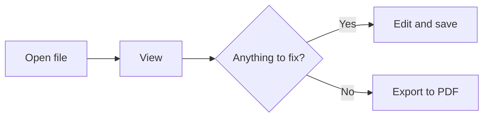

# markcont feature examples

Open this document to see everything the viewer can show, all in one place. Press Edit (`Ctrl+E`) to see it side by side with the source.

## 1. Text formatting

**Bold**, *italic*, ~~strikethrough~~, `inline code`, ==highlight==, ++inserted text++, <kbd>Ctrl</kbd>+<kbd>S</kbd>.

## 2. Callouts

> [!NOTE]
> Something to note. It's the same syntax as GitHub.

> [!TIP]
> A handy tip.

> [!IMPORTANT]
> Something you shouldn't miss.

> [!WARNING] A custom title
> You can change the title, too.

> [!CAUTION]
> Something to be careful about.

> [!EXAMPLE]-
> This one starts folded. Click the title to unfold it.

## 3. Task lists

- [x] Open the viewer
- [ ] Click a checkbox (the source changes too)
- [ ] Fold a section with the arrow next to its heading

## 4. Footnotes

You can add footnotes to the text[^1]. Inline footnotes like this work too^[A footnote written right inside the text].

[^1]: They're collected and shown at the very bottom of the document.

## 5. Tables and definition lists

| Feature | Shortcut |
| --- | --- |
| Edit | `Ctrl+E` |
| Save | `Ctrl+S` |
| Focus mode | `Ctrl+.` |

Markdown
: A document format written in plain text.

Viewer
: This page, which shows Markdown nicely.

## 6. Code and math

```javascript
function hello(name) {
  return `Hello, ${name}!`;
}
```

Math inside a sentence, $e^{i\pi} + 1 = 0$, and math on its own line:

$$
\sum_{i=1}^{n} i = \frac{n(n+1)}{2}
$$

A $ in front of a number, like prices $5 and $10, doesn't turn into math.

## 7. Diagrams



## 8. Links

- To another document: [Example document](sample.md), wikilink [[sample#표|the table in sample]]
- To a heading in this document: [[#3. Task lists]]
- A YouTube link on its own line becomes a thumbnail:

https://www.youtube.com/watch?v=jNQXAC9IVRw
