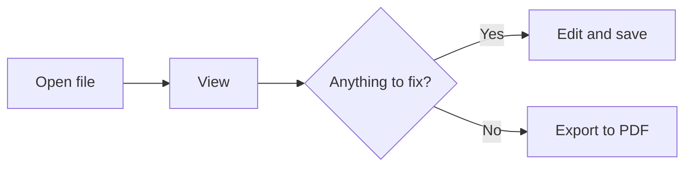

# markcont feature examples

Open this document to see everything the viewer can show, all in one place. Press Edit (`Ctrl+E`) to see it side by side with the source.

The table of contents below comes from a single `[[_TOC_]]` line in the text. Turn on "Number the headings" in View settings (**Aa**) to put 1 · 1.1 numbers in front of the headings.

[[_TOC_]]

## 1. Text formatting

**Bold**, *italic*, ~~strikethrough~~, `inline code`, ==highlight==, ++inserted text++, --deleted text--, <kbd>Ctrl</kbd>+<kbd>S</kbd>.

In Korean, Chinese and Japanese text, bold that ends in a bracket, quote or punctuation still works when a character follows right after it: **스크립트(script)**는, **"인용"**이라고, **10%**의, **「強調」**です.

Suggestion marks: the payment screen is final {~~next week~>this week~~}{>>schedule moved up<<}. Add {++a new item++} and drop the {--needless--} words. Click a mark to accept or reject it.

## 2. Callouts

> [!NOTE]
> Something to note. It's the same syntax as GitHub.

> [!TIP]
> A handy tip.

> [!IMPORTANT]
> Something you shouldn't miss.

> [!WARNING] A custom title
> You can change the title, too.

> [!CAUTION]
> Something to be careful about.

> [!EXAMPLE]-
> This one starts folded. Click the title to unfold it.

## 3. Task lists

- [x] Open the viewer
- [ ] Click a checkbox (the source changes too)
- [ ] Fold a section with the arrow next to its heading

## 4. Footnotes

You can add footnotes to the text[^1]. Inline footnotes like this work too^[A footnote written right inside the text].

[^1]: They're collected and shown at the very bottom of the document.

## 5. Tables and definition lists

| Feature | Shortcut |
| --- | --- |
| Edit | `Ctrl+E` |
| Save | `Ctrl+S` |
| Focus mode | `Ctrl+.` |

Markdown
: A document format written in plain text.

Viewer
: This page, which shows Markdown nicely.

## 6. Code and math

```javascript
function hello(name) {
  return `Hello, ${name}!`;
}
```

Math inside a sentence, $e^{i\pi} + 1 = 0$, and math on its own line:

$$
\sum_{i=1}^{n} i = \frac{n(n+1)}{2}
$$

A $ in front of a number, like prices $5 and $10, doesn't turn into math.

## 7. Diagrams



markcont-style flowchart (user · system zones, yes = blue · no = red):

```flow
# F1 Working with a document
F1-01 | user | action | Open file | → F1-02
F1-02 | system | decision | Is it markdown? | yes → F1-03 / no → F1-04
F1-03 | system | output | [Screen] View document | → F1-05
F1-04 | system | output | [Notice] Can't open file | —
F1-05 | user | action | Pick Edit | → F1-06
F1-06 | user | input | Edit and save | → F1-03
```

Message order and timeline:

```sequence
participants: Me(user), markcont, Claude
Me -> markcont: Open folder
Claude -> markcont: Read document
Claude -> markcont: Edit document
markcont --> Me: Show changes
```

```timeline
today hide
section Prepare
Gather material: 2026-11-02, 3d, done
Write draft: 4d
section Finish
Review: 2d
◆ Share: 2026-11-12
```

## 8. Links

- To another document: [User guide](User-Guide.md), wikilink [[Markdown-Writing-Rules#7-2. Diagrams (markcont style)|the diagrams chapter of the writing rules]]
- To a heading in this document: [[#3. Task lists]]
- Hover over a link or a footnote number to see its content in a small window (long-press on phones)
- A YouTube link on its own line becomes a thumbnail:

https://youtu.be/SEgHM748yrE?si=HsLb-OZOiQqXq3ng

## 9. Images

Click an image to enlarge it. When an image sits alone on its own line, its description shows under it, and a number at the end of the description, like `|96`, sets the width.


