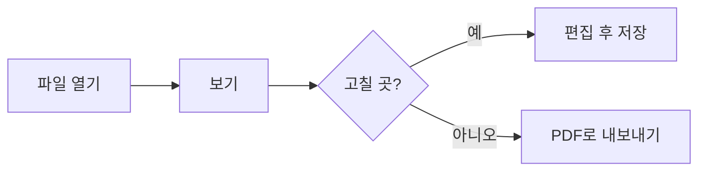

# markcont 기능 예제

이 문서를 열면 뷰어가 보여줄 수 있는 것을 한 번에 확인할 수 있습니다. 편집(`Ctrl+E`)을 눌러 원본과 나란히 보세요.

## 1. 글자 꾸미기

**굵게**, *기울임*, ~~취소선~~, `인라인 코드`, ==형광펜==, ++추가된 글++, <kbd>Ctrl</kbd>+<kbd>S</kbd>.

## 2. 알림 상자

> [!NOTE]
> 참고할 내용입니다. GitHub와 같은 문법입니다.

> [!TIP]
> 알아두면 좋은 팁입니다.

> [!IMPORTANT]
> 놓치면 안 되는 내용입니다.

> [!WARNING] 직접 정한 제목
> 제목을 바꿀 수도 있습니다.

> [!CAUTION]
> 조심해야 하는 내용입니다.

> [!EXAMPLE]-
> 처음에는 접혀 있습니다. 제목을 누르면 펼쳐집니다.

## 3. 체크리스트

- [x] 뷰어 열기
- [ ] 체크박스를 눌러 보기 (원본도 같이 바뀝니다)
- [ ] 제목 옆 화살표로 접어 보기

## 4. 각주

본문에 각주를 달 수 있습니다[^1]. 이렇게 바로 쓰는 각주도 됩니다^[본문 안에 바로 쓴 각주입니다].

[^1]: 문서 맨 아래에 모여서 표시됩니다.

## 5. 표와 정의 목록

| 기능 | 단축키 |
| --- | --- |
| 편집 | `Ctrl+E` |
| 저장 | `Ctrl+S` |
| 집중 모드 | `Ctrl+.` |

마크다운
: 일반 텍스트로 쓰는 문서 형식입니다.

뷰어
: 마크다운을 보기 좋게 보여주는 이 페이지입니다.

## 6. 코드와 수식

```javascript
function hello(name) {
  return `안녕하세요, ${name}님!`;
}
```

문장 안의 수식 $e^{i\pi} + 1 = 0$ 과 따로 쓴 수식:

$$
\sum_{i=1}^{n} i = \frac{n(n+1)}{2}
$$

가격 $5 와 $10 처럼 숫자 앞의 $ 는 수식이 되지 않습니다.

## 7. 다이어그램



## 8. 링크

- 다른 문서로: [예제 문서](sample.md), 위키링크 [[sample#표|sample의 표]]
- 이 문서 안의 제목으로: [[#3. 체크리스트]]
- 유튜브 링크만 따로 쓰면 썸네일이 됩니다:

https://www.youtube.com/watch?v=jNQXAC9IVRw
