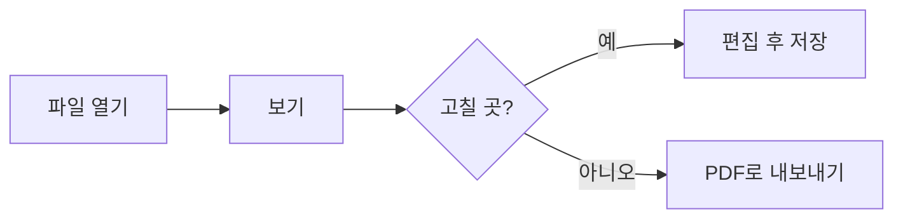

# markcont 기능 예제

이 문서를 열면 뷰어가 보여줄 수 있는 것을 한 번에 확인할 수 있습니다. 편집(`Ctrl+E`)을 눌러 원본과 나란히 보세요.

아래 목차는 본문에 `[[_TOC_]]` 한 줄을 써서 만든 것입니다. 보기 설정(**Aa**)에서 「제목에 번호 붙여 보기」를 켜면 제목 앞에 1 · 1.1 번호가 붙습니다.

[[_TOC_]]

## 1. 글자 꾸미기

**굵게**, *기울임*, ~~취소선~~, `인라인 코드`, ==형광펜==, ++추가된 글++, --제거된 글--, <kbd>Ctrl</kbd>+<kbd>S</kbd>.

괄호 · 따옴표 · 문장부호로 끝나는 굵게 뒤에 조사가 붙어도 굵게가 됩니다: **스크립트(script)**는, **"인용"**이라고, **10%**의, *기울임(괄호)*을.

## 2. 알림 상자

> [!NOTE]
> 참고할 내용입니다. GitHub와 같은 문법입니다.

> [!TIP]
> 알아두면 좋은 팁입니다.

> [!IMPORTANT]
> 놓치면 안 되는 내용입니다.

> [!WARNING] 직접 정한 제목
> 제목을 바꿀 수도 있습니다.

> [!CAUTION]
> 조심해야 하는 내용입니다.

> [!EXAMPLE]-
> 처음에는 접혀 있습니다. 제목을 누르면 펼쳐집니다.

## 3. 체크리스트

- [x] 뷰어 열기
- [ ] 체크박스를 눌러 보기 (원본도 같이 바뀝니다)
- [ ] 제목 옆 화살표로 접어 보기

## 4. 각주

본문에 각주를 달 수 있습니다[^1]. 이렇게 바로 쓰는 각주도 됩니다^[본문 안에 바로 쓴 각주입니다].

[^1]: 문서 맨 아래에 모여서 표시됩니다.

## 5. 표와 정의 목록

| 기능 | 단축키 |
| --- | --- |
| 편집 | `Ctrl+E` |
| 저장 | `Ctrl+S` |
| 집중 모드 | `Ctrl+.` |

마크다운
: 일반 텍스트로 쓰는 문서 형식입니다.

뷰어
: 마크다운을 보기 좋게 보여주는 이 페이지입니다.

## 6. 코드와 수식

```javascript
function hello(name) {
  return `안녕하세요, ${name}님!`;
}
```

문장 안의 수식 $e^{i\pi} + 1 = 0$ 과 따로 쓴 수식:

$$
\sum_{i=1}^{n} i = \frac{n(n+1)}{2}
$$

가격 $5 와 $10 처럼 숫자 앞의 $ 는 수식이 되지 않습니다.

## 7. 다이어그램



markcont 방식 흐름도 (유저 · 시스템 구역, 예 = 파랑 · 아니오 = 빨강):

```flow
# F1 문서 다루기
F1-01 | 유저 | 행동 | 파일 열기 | → F1-02
F1-02 | 시스템 | 조건 | 마크다운 파일인가? | 예 → F1-03 / 아니오 → F1-04
F1-03 | 시스템 | 출력 | [화면] 문서 보기 | → F1-05
F1-04 | 시스템 | 출력 | [안내] 열 수 없는 파일 | —
F1-05 | 유저 | 행동 | 편집 선택 | → F1-06
F1-06 | 유저 | 입력 | 고치고 저장 | → F1-03
```

주고받는 순서 · 일정표:

```sequence
참여: 나(유저), markcont, Claude
나 -> markcont: 폴더 열기
Claude -> markcont: 문서 읽기
Claude -> markcont: 문서 고치기
markcont --> 나: 바뀐 곳 표시
```

```timeline
오늘 숨기기
묶음 준비
자료 모으기: 2026-11-02, 3일, 완료
초안 쓰기: 4일
묶음 마무리
검토: 2일
◆ 공유: 2026-11-12
```

## 8. 링크

- 다른 문서로: [사용 안내서](사용-안내서.md), 위키링크 [[마크다운-작성-규칙#7-2. 다이어그램 (markcont 방식)|작성 규칙의 다이어그램 장]]
- 이 문서 안의 제목으로: [[#3. 체크리스트]]
- 유튜브 링크만 따로 쓰면 썸네일이 됩니다:

https://youtu.be/SEgHM748yrE?si=HsLb-OZOiQqXq3ng

## 9. 그림

그림을 누르면 크게 볼 수 있습니다. 그림만 한 줄에 쓰면 설명이 그림 아래에 나오고, 설명 끝에 `|96` 처럼 숫자를 붙이면 폭이 정해집니다.


