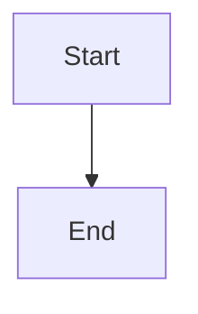
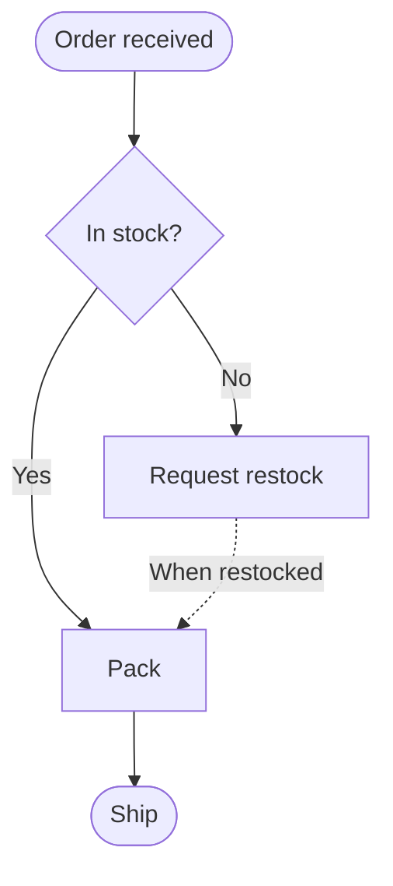
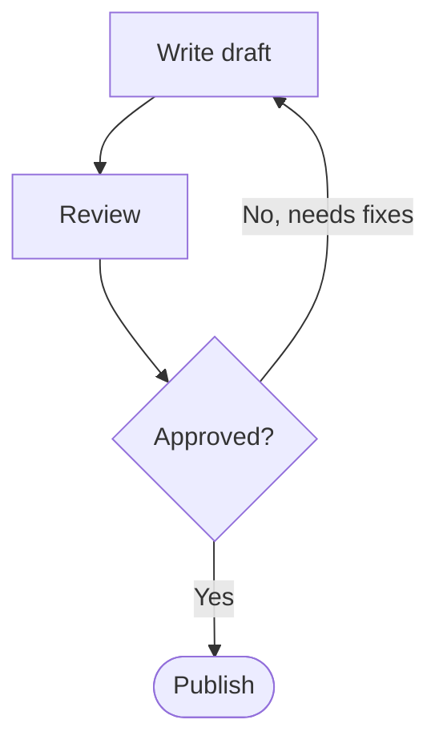
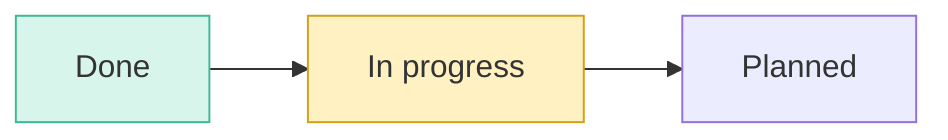
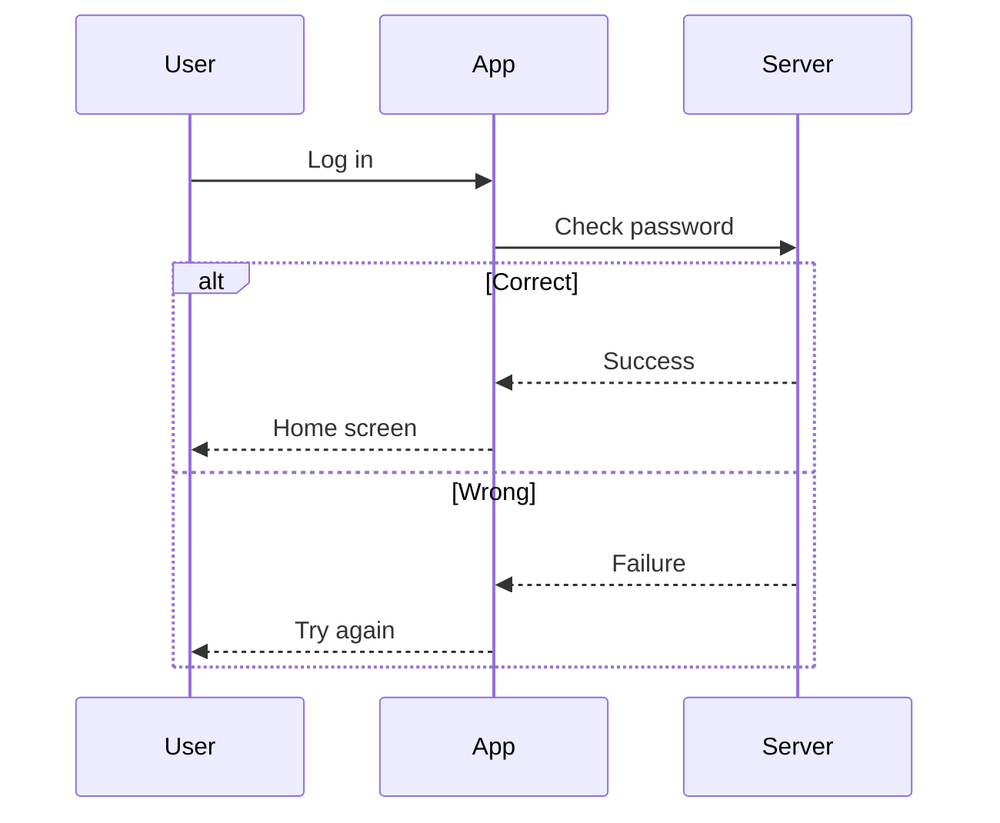
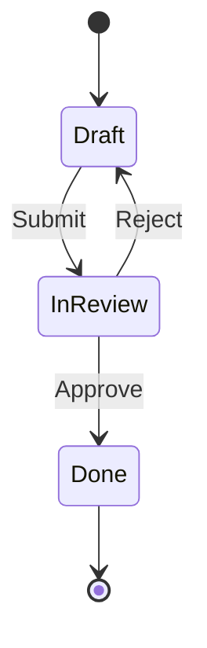
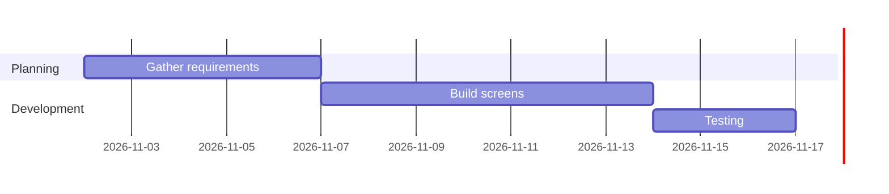

# 📐 Rules for Good-Looking Markdown

Follow these rules and your documents will be easy to take in at a glance in markcont.
When you ask an AI to write a document, give it this file too and say **"Rewrite this following these rules."**

> [!TIP]
> Sections 1–8 mostly look the same on GitHub and Obsidian too.
> **Section 9, markcont extended syntax**, covers extra syntax that markcont supports, so it may show up as plain text elsewhere. See the table in section 9 for where each one works.

> [!NOTE]
> Examples show the source on the **left (✏️ Write this)** and the result on the **right (👀 Looks like this)**, side by side.

---

## 1️⃣ Document structure

| Rule | Like this | Why |
|:---|:---|:---|
| **Only one** title (`#`) per document | `# 👋 About the project` | The top title becomes the document's name |
| Big sections use `##` + **one emoji** | `## 🚀 Getting started` | Sections stand out right away in the outline and the text |
| Small sections use `###`, no emoji | `### How to install` | They look lighter than big sections |
| A divider `---` between `##` sections | | Section boundaries are clear on screen |
| A **one- or two-line summary** right under the title | | Readers can decide right away whether to read on |

```markdown example
# 👋 About the project

A quick overview of the app our team is building.

## 🚀 Getting started

### How to install

Download the installer and run it.

---

## ❓ FAQ
```

### Common section emoji

| Emoji | Use for | Emoji | Use for |
|:---:|:---|:---:|:---|
| 👋 | Document title, greetings | 🚀 | Getting started, key features |
| ✨ | Basic features, highlights | ✅ | To-dos, checklists |
| 📊 | Tables, comparisons, numbers | 💬 | Emphasis, notices |
| 💻 | Code, commands | 🔗 | Links, references |
| ❓ | FAQ | 🎯 | Wrap-up, next steps |
| ⚠️ | Warnings | 📝 | Notes, change log |

---

## 2️⃣ Use callouts for emphasis

Don't just bold important sentences; put them in a **callout**. Stick to these five types.

```markdown example
> [!NOTE]
> Good to know

> [!TIP]
> A better way to do it

> [!IMPORTANT]
> Key point you must know

> [!WARNING]
> Easy to get wrong

> [!CAUTION]
> Risky and hard to undo
```

- Use **at most two** callouts per section. Too many and nothing stands out.
- To set your own title, write `> [!TIP] My own title`.
- To make it collapsible, write `> [!NOTE]-` (collapsed at first) or `> [!NOTE]+` (expanded at first).

---

## 3️⃣ Text formatting

| Use | How to write | Result |
|:---|:---|:---|
| Key words | `**bold**` | **bold** |
| Soft emphasis | `*italic*` | *italic* |
| Point out one spot | `==highlight==` | ==highlight== |
| Outdated content | `~~strikethrough~~` | ~~strikethrough~~ |
| File names, commands, button names | `` `code` `` | `code` |
| Keyboard shortcuts | `<kbd>Ctrl</kbd>+<kbd>S</kbd>` | <kbd>Ctrl</kbd>+<kbd>S</kbd> |

```markdown example
Installing takes just **3 minutes**. *Really.*
==If you don't save, it's gone.== Use `npm install` instead of ~~the old way~~.
Save with <kbd>Ctrl</kbd>+<kbd>S</kbd>.
```

- Use the highlight **only once** per section.
- Don't bold a whole sentence. Bold just the words.

---

## 4️⃣ Lists and checklists

- If order matters, use a `1.` numbered list; otherwise use a `-` bullet list.
- Put **one thing per line** in a list item.
- Write to-dos as a checklist. You can click to check them off in the viewer.

```markdown example
1. Open the file
2. Edit the content
3. Save

- Apple
- Banana
  - Ripe banana

- [x] Done
- [ ] Still to do
```

---

## 5️⃣ Tables

- When comparing things or listing settings, use a **table** instead of sentences.
- The position of `:` in the second row sets the alignment: left `:---`, center `:---:`, right `---:`
- Center short values (yes/no, numbers) and left-align descriptions.

```markdown example
| Setting | Options | Description |
|:---|:---:|:---|
| Theme | Light / Dark | Whatever is easy on your eyes |
| Font size | 13 ~ 24 | As you like |
```

---

## 6️⃣ Code

- **Always** write the language name on a code block. That gives it colors and shows the language in the header.
- Show changes with `diff`. `-` lines show in red, `+` lines in green.

````markdown example
```javascript
console.log("Hello");
```

```diff
- Old way
+ New way
```
````

---

## 7️⃣ Images, diagrams, math

### 7-1. Images

| What you want | How to write |
|:---|:---|
| Add an image | `` |
| A title that shows on mouse hover | `` |
| A file name with spaces | `` |
| An image from the web | `` |
| Set the size | `` |
| Center it | `<p align="center"></p>` |
| An image you can click to go somewhere | `[](https://example.com)` |
| Add by name only (wiki style) | `![[picture.png]]` |
| Video · audio | `` · `` |

**How to write paths**: start from the folder the current document is in.

| Where the image is | How to write |
|:---|:---|
| Same folder as the document | `picture.png` |
| A folder below | `images/picture.png` |
| A folder above | `../picture.png` |

```markdown example


<p align="center"></p>
```

- **Always** write the description inside `[ ]`. It shows when the image can't load, and screen readers read it aloud.
- Keeping images together in an `images/` folder inside the document folder makes them easy to manage.
- Images in a folder only show in documents opened with **Open folder**. If you open a single file, it can't read images in the same folder.

---

### 7-2. Diagrams (Mermaid)

````markdown

````

Write `mermaid` as the code block language, and put the **diagram type** on the first line.

| First line | Type | Use for |
|:---|:---|:---|
| `flowchart TD` | Flowchart (top → bottom) | Workflows, branches, loops |
| `flowchart LR` | Flowchart (left → right) | Short steps |
| `sequenceDiagram` | Back-and-forth sequence | Conversations between people · systems |
| `stateDiagram-v2` | State changes | Order · document status |
| `gantt` | Schedule | Project timelines |
| `pie` | Pie chart | Proportions |
| `mindmap` | Mind map | Organizing ideas |

#### Flowchart: box shapes

| How to write | Shape | Use for |
|:---|:---|:---|
| `A[text]` | Rectangle | Normal step |
| `A(text)` | Rounded rectangle | Softer step |
| `A([text])` | Pill | Start · end |
| `A{text}` | Diamond | **Branch (yes/no)** |
| `A((text))` | Circle | Connector |
| `A[(text)]` | Cylinder | Storage · DB |
| `A[[text]]` | Double rectangle | Calling another flow |

#### Flowchart: arrows

| How to write | Shape |
|:---|:---|
| `A --> B` | Arrow |
| `A --- B` | Line only |
| `A -.-> B` | Dotted arrow (optional · exception) |
| `A ==> B` | Thick arrow (main path) |
| `A -->|yes| B` | Text on the arrow |
| `A --> B & C` | To several places at once |

#### Branches: splitting by condition

Send several arrows out of a diamond `{ }`, and add a `|condition|` to each arrow.

````markdown example

````

#### Going back: repeating an earlier step

Just point an arrow back to an **earlier box**. Write the repeat condition as the arrow text.

````markdown example

````

#### Groups: boxing steps together

Boxes placed between `subgraph name` and `end` are shown as one group. Groups can be connected with arrows too.

````markdown example

````

#### Adding color

Define a color with `classDef name fill:background,stroke:border`, then apply it with `class boxes name`.

````markdown example

````

#### Back-and-forth sequences (with conditions · loops)

| How to write | Meaning |
|:---|:---|
| `A->>B: text` | Send (solid line) |
| `B-->>A: text` | Reply (dotted line) |
| `alt condition` ~ `else` ~ `end` | Different flow depending on a condition |
| `loop condition` ~ `end` | Loop |
| `Note over A,B: text` | Note |

````markdown example

````

#### State changes · schedules

````markdown example

````

````markdown example

````

#### Diagram rules

1. Use **short English IDs** for boxes (`A`, `B`, `start`), and put the visible text inside `[ ]`.
2. If the text contains symbols like parentheses or commas, wrap it in quotes: `A["Check (required)"]`
3. To break a line inside a box, use `<br>`: `A[Step 1<br>Prepare]`
4. Keep it to **15 boxes or fewer** per diagram. If you have more, group them with `subgraph` or split into two.
5. Keep the flow in one direction (`TD` or `LR`); only arrows that go back run the other way.
6. If the syntax is wrong, an error message appears where the diagram should be. Start by checking the line you changed last.

---

### 7-3. Math (KaTeX)

| Where | How to write |
|:---|:---|
| Inside a sentence | `$E = mc^2$` |
| On its own, large | Between two `$$` lines, or in a ```` ```math ```` block |

| What you want | How to write | Result |
|:---|:---|:---|
| Superscript · subscript | `x^2`, `a_i`, `x^{10}` | $x^2$, $a_i$, $x^{10}$ |
| Fraction | `\frac{a}{b}` | $\frac{a}{b}$ |
| Square root | `\sqrt{x}`, `\sqrt[3]{x}` | $\sqrt{x}$, $\sqrt[3]{x}$ |
| Sum · product | `\sum_{i=1}^{n} i`, `\prod_{k=1}^{n} k` | $\sum_{i=1}^{n} i$, $\prod_{k=1}^{n} k$ |
| Integral · limit | `\int_a^b f(x)\,dx`, `\lim_{x \to 0}` | $\int_a^b f(x)\,dx$, $\lim_{x \to 0}$ |
| Greek letters | `\alpha \beta \pi \theta \Delta \Sigma` | $\alpha \beta \pi \theta \Delta \Sigma$ |
| Multiply · divide | `\times \div \cdot \pm` | $\times \div \cdot \pm$ |
| Comparison | `\le \ge \ne \approx \equiv` | $\le \ge \ne \approx \equiv$ |
| Arrows | `\to \Rightarrow \Leftrightarrow` | $\to \Rightarrow \Leftrightarrow$ |
| Sets | `\in \notin \subset \cup \cap \emptyset` | $\in \notin \subset \cup \cap \emptyset$ |
| Vector · mean | `\vec{v}`, `\bar{x}`, `\hat{y}` | $\vec{v}$, $\bar{x}$, $\hat{y}$ |
| Words inside math | `\text{speed} = \frac{\text{distance}}{\text{time}}` | $\text{speed} = \frac{\text{distance}}{\text{time}}$ |

````markdown example
Align several lines on the equals sign.

$$
\begin{aligned}
(a+b)^2 &= (a+b)(a+b) \\
        &= a^2 + 2ab + b^2
\end{aligned}
$$

Split by cases.

$$
|x| = \begin{cases} x & (x \ge 0) \\ -x & (x < 0) \end{cases}
$$

Matrices work too: $\begin{pmatrix} 1 & 2 \\ 3 & 4 \end{pmatrix}$
````

**Math rules**

1. To raise or lower two or more characters, group them with `{ }`: `x^{10}` (without it, `x^10` → $x^10$)
2. Wrap words inside math in `\text{ }`.
3. `\\` is a line break and `&` is the alignment point (inside `aligned`, `cases`, and matrices).
4. For a literal `$`, such as in a price, write `\$`.

---

### 7-4. Chemical formulas (mhchem)

Use `\ce{ }` inside math to draw it by chemistry rules. Numbers automatically become subscripts.

| What you want | How to write | Result |
|:---|:---|:---|
| Molecule | `$\ce{H2O}$`, `$\ce{C6H12O6}$` | $\ce{H2O}$, $\ce{C6H12O6}$ |
| Ion | `$\ce{Na+}$`, `$\ce{SO4^2-}$` | $\ce{Na+}$, $\ce{SO4^2-}$ |
| Reaction | `$\ce{2H2 + O2 -> 2H2O}$` | $\ce{2H2 + O2 -> 2H2O}$ |
| Reversible reaction | `$\ce{N2 + 3H2 <=> 2NH3}$` | $\ce{N2 + 3H2 <=> 2NH3}$ |
| Reaction conditions | `$\ce{CaCO3 ->[\Delta] CaO + CO2}$` | $\ce{CaCO3 ->[\Delta] CaO + CO2}$ |
| State of matter | `$\ce{NaCl(aq)}$`, `$\ce{H2O(l)}$` | $\ce{NaCl(aq)}$, $\ce{H2O(l)}$ |
| Gas · precipitate | `$\ce{CO2 ^}$`, `$\ce{AgCl v}$` | $\ce{CO2 ^}$, $\ce{AgCl v}$ |
| Hydrate | `$\ce{CuSO4*5H2O}$` | $\ce{CuSO4*5H2O}$ |
| Isotope | `$\ce{^{14}_{6}C}$` | $\ce{^{14}_{6}C}$ |

```markdown example
The equation for photosynthesis is:

$$
\ce{6CO2 + 6H2O ->[\text{light}] C6H12O6 + 6O2}
$$
```

---

## 8️⃣ Footnotes and collapsible content

### Footnotes

- Write `[^1]` in the text, and a line `[^1]: explanation` **anywhere** in the document.
- Wherever you put the explanation line, on screen they're **always gathered at the bottom** of the document in number order. You don't have to put them at the end.
- For easy upkeep, we recommend putting it **right below that paragraph**.
- Names work instead of numbers too: `[^source]`, `[^note]`

**How to check it worked**

| Status | What you see |
|:---|:---|
| Explanation exists | A small superscript number. Click it to jump to the explanation below; click ↩ to come back |
| Explanation missing | `[^1]` shows as plain text with a **red dotted line** |

```markdown example
markcont can also be used as a web app[^web].

[^web]: On a phone, add it to your home screen and it opens like an app.

Here's what a missing explanation looks like[^missing].
```

### Collapsible content

Fold away content people only need sometimes, like FAQs. Leave a **blank line** after `<summary>` and before `</details>` so the Markdown inside shows properly.

```markdown example
<details>
<summary>Do I need to install it?</summary>

No. Just open the **web address** and start using it.

</details>
```

---

## 9️⃣ markcont extended syntax

This syntax isn't part of standard Markdown (CommonMark), but markcont understands it.
Check **where it works** first, and if the document will be opened elsewhere too, pick the options with more ✅.

### Where does it work?

| Syntax | How to write | markcont | GitHub | Obsidian |
|:---|:---|:---:|:---:|:---:|
| 5 callout types | `> [!NOTE]` | ✅ | ✅ | ✅ |
| 6 extra callout types | `> [!INFO]` `> [!TODO]` … | ✅ | ❌ | ✅ |
| Collapsible callouts | `> [!NOTE]-` · `> [!NOTE]+` | ✅ | ❌ | ✅ |
| Custom callout title | `> [!TIP] My title` | ✅ | ❌ | ✅ |
| Highlight | `==text==` | ✅ | ❌ plain text | ✅ |
| Inserted text | `++text++` | ✅ | ❌ plain text | ❌ |
| Footnote | `text[^1]` + `[^1]: explanation` | ✅ | ✅ | ✅ |
| Inline footnote | `text^[explanation]` | ✅ | ❌ | ✅ |
| Definition list | `term` + next line `: definition` | ✅ | ❌ | ❌ |
| Math | `$…$` · `$$…$$` | ✅ | ✅ | ✅ |
| Math block | ```` ```math ```` | ✅ | ✅ | ❌ |
| Chemical formula | `$\ce{H2O}$` | ✅ | ❌ | ❌ |
| Diagram | ```` ```mermaid ```` | ✅ | ✅ | ✅ |
| Wikilink | `[[document]]` · `[[document#heading\|alias]]` | ✅ | ❌ | ✅ |
| Embed image (wiki style) | `![[picture.png]]` | ✅ | ❌ | ✅ |
| Video · audio | `` | ✅ | ❌ broken image | ✅ |
| YouTube thumbnail | A YouTube URL alone on a line | ✅ | ❌ link | ❌ link |
| Document info | `name: value` between `---` lines at the very top | ✅ info box | ⚠️ table | ✅ |
| Collapsible content | `<details>` | ✅ | ✅ | ✅ |
| Keyboard keys | `<kbd>Ctrl</kbd>` | ✅ | ✅ | ✅ |
| Source · result side by side | ```` ```markdown example ```` | ✅ | ❌ shown as code | ❌ shown as code |

<sub>The GitHub and Obsidian columns show behavior with default settings as of November 2026. It may differ by version or plugins.</sub>

### Callouts: 11 types and collapsing

On top of the same 5 types as GitHub (`NOTE` · `TIP` · `IMPORTANT` · `WARNING` · `CAUTION`), there are 6 more.

| How to write | Label shown | Use for |
|:---|:---|:---|
| `> [!INFO]` | ℹ️ INFO | Extra information |
| `> [!TODO]` | ☑️ TODO | To-dos |
| `> [!EXAMPLE]` | 📋 EXAMPLE | Examples |
| `> [!QUESTION]` | ❓ QUESTION | Questions |
| `> [!FAQ]` | ❓ FAQ | Frequently asked questions |
| `> [!DANGER]` | ⛔ DANGER | Very dangerous things |

```markdown example
> [!INFO]
> Here's some extra information.

> [!EXAMPLE]- Click to expand
> Collapsed at first.

> [!TODO]+ Today's tasks
> Expanded at first; click the title to collapse it.

> [!DANGER]
> This is very dangerous.
```

- `-` means **collapsed at first**, `+` means **expanded at first**.
- Text written right after `[!TYPE]` becomes the title.
- Choose the callout look (💡 NOTE / ⓘ Note) in **View settings (Aa) → Callout style**.

### Highlight · inserted text

```markdown example
Highlight only ==the single most important phrase==.
In a revised document, mark newly added words ++like this++.
```

#### Keeping symbols from turning into formatting by mistake

`~`, `==`, and `++` show up a lot in everyday writing, so markcont **only treats them as formatting in narrow cases**.

| If you write | markcont shows | Why |
|:---|:---|:---|
| `Seoul~Busan`, `~10 to ~20` | Plain text | Strikethrough needs **two** tildes: `~~text~~` |
| `x==1 and y==2` | Plain text | `==` attached to letters or numbers isn't a highlight |
| `a == b == c` | Plain text | A space just inside the symbols means it isn't a highlight |
| `C++`, `i++ and j++` | Plain text | `++` attached to letters isn't inserted text |
| `` `a == b` ``, `$a == b$` | Code · math | Inside code and math, it's always left as is |
| `==중요==를` | Highlight | Korean (Hangul) letters may touch it |

```markdown example
10:00~12:00, Seoul~Busan
Check whether x==1 and y==2
==just this part== highlighted, ~~just this part~~ struck through
```

**If you still want the symbols shown as plain text**, put `\` in front of them.

```markdown example
\=\=as is\=\= · \~\~as is\~\~ · \+\+as is\+\+
```

> [!WARNING]
> **On GitHub, a single tilde** `~text~` also becomes strikethrough. If the document will go on GitHub too, write ranges like `10:00-12:00` or `10:00 ~ 12:00` (with spaces), or use `\~`. For subscripts, write `H<sub>2</sub>O`.

### Inline footnotes · definition lists

```markdown example
Write a footnote right in the text^[No need to pick a number.].

Markdown
: A format for making tidy documents with just a few symbols

markcont
: A viewer for reading and editing Markdown nicely
: You can add more than one definition
```

### Math · chemical formulas

| How to write | Result |
|:---|:---|
| `$E = mc^2$` | $E = mc^2$ |
| `$\frac{a}{b}$` | $\frac{a}{b}$ |
| `$\ce{H2O}$` | $\ce{H2O}$ |
| `$\ce{2H2 + O2 -> 2H2O}$` | $\ce{2H2 + O2 -> 2H2O}$ |

- Write large formulas between two `$$` lines or in a ```` ```math ```` block.
- To write `$` as a character, like a price, put `\` in front: `\$5`. A `$` with a number right after it, like `$5`, isn't treated as math.

### Wikilinks · embedding images

Links that jump straight to another document when you've opened a folder. Leave out the `.md`.

| How to write | What it does |
|:---|:---|
| `[[Meeting notes]]` | Opens Meeting notes.md |
| `[[Meeting notes#Decisions]]` | Goes to the "Decisions" heading in that document |
| `[[Meeting notes#Decisions\|See decisions]]` | Shows the link text as "See decisions" |
| `[[#3️⃣ Text formatting]]` | Goes to a heading in this document |
| `![[picture.png]]` | Embeds an image in the folder by name only |

- If you write just a document name, markcont looks for **that name across the whole folder**. If several share the name, write a path like `[[docs/Meeting notes]]`.
- A link to a document that doesn't exist shows as a faint dotted link. A link with no heading, like `[[document]]`, is left as plain text if the document it points to doesn't exist.
- Regular links like `[text](other-doc.md)` also open right inside markcont.

### Video · audio · YouTube

```markdown


https://www.youtube.com/watch?v=jNQXAC9IVRw
```

- Put a video (`mp4` `webm` `mov`) or audio (`mp3` `wav` `m4a` `flac`) file in image syntax and it shows as a **player**.
- A YouTube URL **on a line by itself** becomes a thumbnail. A URL in the middle of a sentence stays a plain link.

### Document info (`---` at the top)

```markdown
---
title: November meeting notes
author: RyuSeoJin
tags:
  - meeting
  - 2026
---
```

- Wrap lines in `---` starting from the **very first line** of the document, and they're shown neatly in a **document info** box above the text.
- Write one `name: value` per line, and list items as `  - item`.

### Line breaks

| What you want | How to write |
|:---|:---|
| A new paragraph | One blank line |
| A line break within the same paragraph | Two spaces at the end of the line, or `\` |
| Treat each single Enter as a line break | Turn on **View settings (Aa) → Treat single line breaks as line breaks** |

> [!NOTE]
> If the document needs to look the same elsewhere, it's safer to **separate paragraphs with blank lines** than to rely on a setting.

### Showing source and result side by side

Use this when you want to show **"Write this → Looks like this"** side by side, like this document does.
Write `markdown example` where the code block language goes, and the source appears on the left with the result on the right.

`````markdown example
````markdown example
Write **bold** and add a ==highlight== too.
````
`````

- On narrow screens, it splits into top (source) and bottom (result).
- Headings inside examples don't appear in the outline.
- Other programs just show it as a regular Markdown code block.

### What you can't use

| If you write | What happens | Instead |
|:---|:---|:---|
| `<style>` · `<script>` | Removed (for security) | Format with Markdown syntax |
| `~subscript~` | Plain text (strikethrough on GitHub) | `<sub>…</sub>` |
| `^superscript^` | Plain text | `<sup>…</sup>` |
| `:smile:` emoji codes | Plain text | Type the 😄 emoji directly |

---

## 🎯 One-page summary

1. One `#` title, one emoji per `##` section, `---` between sections
2. Emphasis goes in callouts (NOTE · TIP · IMPORTANT · WARNING · CAUTION), up to two per section
3. Tables for comparisons and settings, checklists for to-dos
4. Language names on code blocks, `diff` for changes
5. Flows in mermaid (`{ }` for branches, an arrow to an earlier box to go back, `subgraph` for groups), math with `$`, chemistry with `\ce{}`
6. Side notes as footnotes (the explanation line can go anywhere; a missing one shows a red dotted line), Q&A in `<details>`
7. Extended syntax (`==highlight==`, `[[wikilink]]`, `> [!TODO]-` …) may only work in markcont, so check **the table in section 9**
