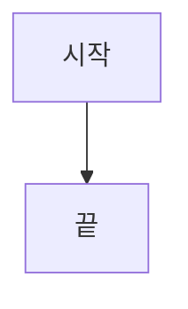
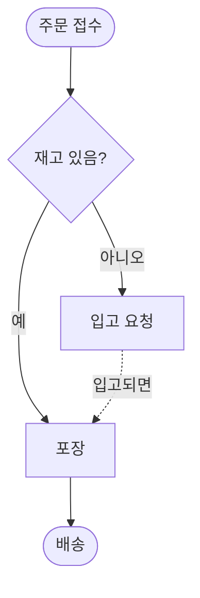
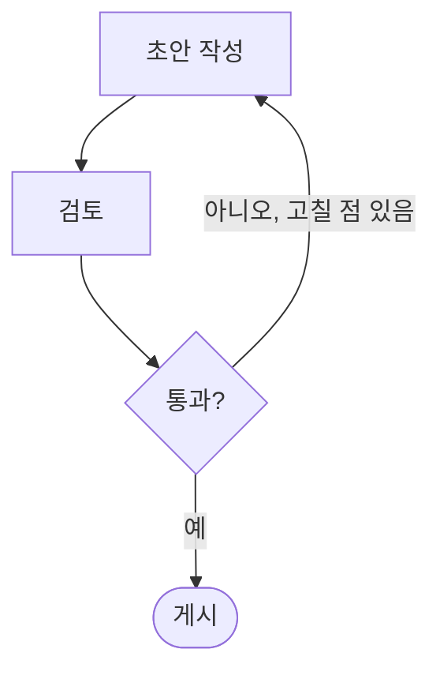
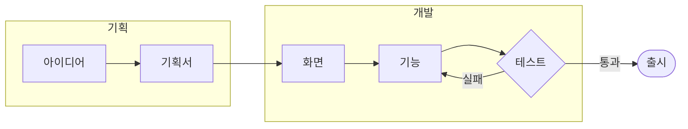
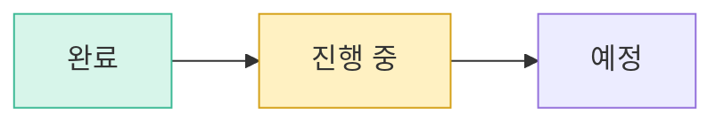
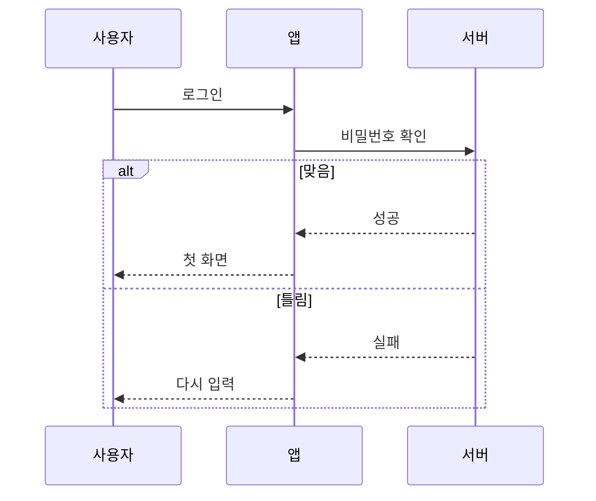
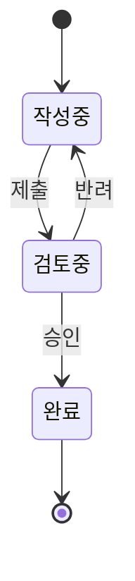
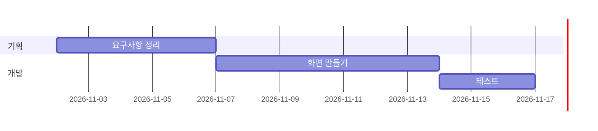

# 📐 보기 좋은 마크다운 작성 규칙

이 규칙대로 쓰면 markcont에서 문서가 한눈에 들어오게 보입니다.
AI에게 문서를 맡길 때는 이 파일을 같이 주고, **어디서 볼 문서인지**에 따라 아래 문구 중 하나를 쓰세요.

| 볼 곳 | AI에게 이렇게 말하세요 |
|:---|:---|
| markcont에서만 | **"이 규칙대로 다시 써 줘"** |
| GitHub · VS Code 등 어디서나 | **"이 규칙대로 다시 쓰되, 9장 표에서 GitHub 칸이 ❌인 문법은 쓰지 마"** |

> [!IMPORTANT]
> 이미 markcont 방식으로 쓴 문서도 걱정하지 않아도 됩니다. 저장 단추 옆 **▾ → 다른 뷰어용으로 저장…** 을 누르면 전용 문법을 표준 문법으로 바꾼 **사본**을 만들어 줍니다(원래 파일은 그대로). 문서에 전용 문법이 있으면 문서 위쪽에 **⚠ 다른 뷰어에서 다르게 보이는 곳 N곳** 이 표시됩니다.

> [!TIP]
> 1~8장은 GitHub · Obsidian에서도 대부분 그대로 보입니다.
> **9장 markcont 확장 문법**은 markcont가 더 지원하는 문법이라, 다른 곳에서는 글자 그대로 보일 수 있습니다. 어디서 되는지는 9장 표를 보세요.

> [!NOTE]
> 예시는 **왼쪽(✏️ 이렇게 쓰면)** 에 원본, **오른쪽(👀 이렇게 보입니다)** 에 결과를 나란히 보여줍니다.

---

## 1️⃣ 문서 구조

| 규칙 | 이렇게 | 이유 |
|:---|:---|:---|
| 제목(`#`)은 문서에 **하나만** | `# 👋 프로젝트 소개` | 맨 위 제목이 문서 이름이 됩니다 |
| 큰 단락은 `##` + **이모지 하나** | `## 🚀 시작하기` | 목차와 본문에서 단락이 바로 구분됩니다 |
| 작은 단락은 `###`, 이모지 없이 | `### 설치 방법` | 큰 단락과 무게가 달라 보입니다 |
| `##` 단락 사이에는 구분선 `---` | | 화면에서 단락 경계가 분명해집니다 |
| 제목 바로 아래 **한두 줄 요약** | | 읽을지 말지 바로 판단할 수 있습니다 |

```markdown example
# 👋 프로젝트 소개

우리 팀이 만드는 앱을 한눈에 정리한 문서입니다.

## 🚀 시작하기

### 설치 방법

설치 파일을 받아 실행하세요.

---

## ❓ 자주 묻는 질문
```

### 자주 쓰는 단락 이모지

| 이모지 | 쓰는 곳 | 이모지 | 쓰는 곳 |
|:---:|:---|:---:|:---|
| 👋 | 문서 첫 제목, 인사 | 🚀 | 시작하기, 주요 기능 |
| ✨ | 기본 기능, 특징 | ✅ | 할 일, 확인 목록 |
| 📊 | 표, 비교, 수치 | 💬 | 강조, 안내 |
| 💻 | 코드, 명령어 | 🔗 | 링크, 참고 자료 |
| ❓ | 자주 묻는 질문 | 🎯 | 마무리, 다음 할 일 |
| ⚠️ | 주의 사항 | 📝 | 메모, 변경 기록 |

---

## 2️⃣ 강조는 알림 상자로

중요한 문장은 굵게만 하지 말고 **알림 상자**에 넣습니다. 종류는 다섯 가지만 씁니다.

```markdown example
> [!NOTE]
> 알아두면 좋은 정보

> [!TIP]
> 더 잘 쓰는 방법

> [!IMPORTANT]
> 꼭 알아야 하는 핵심

> [!WARNING]
> 실수하기 쉬운 부분

> [!CAUTION]
> 되돌리기 어려운 위험
```

- 알림 상자는 한 단락에 **최대 두 개**까지만 씁니다. 많으면 강조가 사라집니다.
- 제목을 직접 정하려면 `> [!TIP] 내가 정한 제목` 처럼 씁니다.
- 접어 두려면 `> [!NOTE]-` (처음에 접힘), `> [!NOTE]+` (처음에 펼침)로 씁니다.

---

## 3️⃣ 글자 꾸미기

| 용도 | 쓰는 법 | 결과 |
|:---|:---|:---|
| 핵심 단어 | `**굵게**` | **굵게** |
| 부드러운 강조 | `*기울임*` | *기울임* |
| 한 곳만 콕 집기 | `==형광펜==` | ==형광펜== |
| 지난 내용 | `~~취소선~~` | ~~취소선~~ |
| 파일 이름, 명령어, 버튼 이름 | `` `코드` `` | `코드` |
| 키보드 단축키 | `<kbd>Ctrl</kbd>+<kbd>S</kbd>` | <kbd>Ctrl</kbd>+<kbd>S</kbd> |

```markdown example
설치는 **3분**이면 끝납니다. *정말로요.*
==저장하지 않으면 사라집니다.== ~~예전 방법~~ 대신 `npm install` 을 쓰세요.
<kbd>Ctrl</kbd>+<kbd>S</kbd> 로 저장합니다.
```

- 형광펜은 한 단락에 **한 번만** 씁니다.
- 한 문장 전체를 굵게 하지 않습니다. 단어만 굵게 합니다.
- 굵게 · 기울임 · 취소선 바로 뒤에 조사를 붙여 씁니다. `**스크립트(script)**는` 처럼 괄호 · 따옴표 · 문장부호로 끝나도 markcont에서는 굵게로 보입니다. GitHub · VS Code에서는 `**` 가 글자 그대로 보이므로, 다른 곳에서도 볼 문서는 **다른 뷰어용으로 저장**하세요. 그런 곳만 `<strong>` 태그로 바뀝니다.

---

## 4️⃣ 목록과 체크리스트

- 순서가 중요하면 `1.` 번호 목록, 아니면 `-` 글머리 목록을 씁니다.
- 목록 항목은 **한 줄에 한 가지**만 씁니다.
- 할 일은 체크리스트로 씁니다. 뷰어에서 눌러서 체크할 수 있습니다.

```markdown example
1. 파일을 엽니다
2. 내용을 고칩니다
3. 저장합니다

- 사과
- 바나나
  - 잘 익은 바나나

- [x] 끝난 일
- [ ] 남은 일
```

---

## 5️⃣ 표

- 비교하거나 설정값을 정리할 때는 문장 대신 **표**를 씁니다.
- 둘째 줄의 `:` 위치로 정렬을 정합니다: 왼쪽 `:---`, 가운데 `:---:`, 오른쪽 `---:`
- 짧은 값(예/아니오, 숫자)은 가운데, 설명은 왼쪽으로 맞춥니다.

```markdown example
| 설정 항목 | 선택지 | 설명 |
|:---|:---:|:---|
| 테마 | 라이트 / 다크 | 눈이 편한 쪽으로 |
| 글자 크기 | 13 ~ 24 | 취향껏 |
```

---

## 6️⃣ 코드

- 코드 블록에는 **언어 이름을 꼭** 씁니다. 그래야 색이 입혀지고 머리줄에 언어가 표시됩니다.
- 바뀐 내용은 `diff`로 보여줍니다. `-` 줄은 빨강, `+` 줄은 초록으로 표시됩니다.

````markdown example
```javascript
console.log("안녕하세요");
```

```diff
- 예전 방식
+ 새 방식
```
````

- 언어 이름 뒤에 빈칸을 두고 `title="파일 이름"` 을 쓰면 머리줄에 **파일 이름**이, `{2,4-5}` 를 쓰면 그 줄에 **강조 띠**가 들어갑니다. MkDocs식 `hl_lines="2 4-5"` 도 됩니다.
- 다른 뷰어(GitHub 등)는 첫 낱말만 언어 이름으로 읽고 나머지는 넘기므로, 제목 · 강조만 빠지고 코드는 그대로 보입니다. 언어 이름에 붙여 쓴 `js{2}` 는 markcont에서는 되지만 GitHub에서는 색이 빠지니 빈칸을 두세요.

````markdown example
```js title="app.js" {2}
const a = 1;
const b = 2; // 이 줄이 강조됩니다
```
````

---

## 7️⃣ 그림, 다이어그램, 수식

### 7-1. 그림

| 하고 싶은 것 | 쓰는 법 |
|:---|:---|
| 그림 넣기 | `` |
| 마우스를 올리면 나오는 제목 | `` |
| 이름에 띄어쓰기가 있는 파일 | `` |
| 인터넷 그림 | `` |
| 크기 정하기 | `` · `` (markcont · Obsidian), 어디서나 되는 `` |
| 가운데 놓기 | `<p align="center"></p>` |
| 누르면 이동하는 그림 | `[](https://주소)` |
| 이름만으로 넣기 (위키식) | `![[그림.png]]` · 폭까지 `![[그림.png\|300]]` |
| 동영상 · 소리 | `` · `` |

**경로 쓰는 법** — 지금 문서가 있는 폴더를 기준으로 씁니다.

| 그림 위치 | 쓰는 법 |
|:---|:---|
| 문서와 같은 폴더 | `그림.png` |
| 아래 폴더 | `images/그림.png` |
| 위 폴더 | `../그림.png` |

```markdown example


<p align="center"></p>
```

- `[ ]` 안의 **설명은 꼭** 씁니다. 그림이 안 열릴 때 대신 보이고, 화면 읽기 프로그램이 읽어 줍니다.
- 그림만 한 줄에 따로 쓰면 markcont는 설명을 **그림 아래**에 작게 보여 줍니다. 그림을 누르면 크게 볼 수 있습니다 (휠 · 두 손가락으로 확대 · 축소).
- 그림은 문서 폴더 안의 `images/` 폴더에 모아 두면 관리하기 쉽습니다.
- 폴더 열기로 연 문서에서만 폴더 안의 그림이 보입니다. 파일 하나만 열면 같은 폴더의 그림을 읽을 수 없습니다.

---

### 7-2. 다이어그램 (markcont 방식)

markcont가 직접 그리는 다이어그램입니다. 흐름도는 **markcont 흐름도 기준**을 따릅니다. 위는 유저 구역, 아래는 시스템 구역이고, 도형마다 뜻이 정해져 있으며, 왼쪽에서 오른쪽으로 흘러갑니다. 선은 수평 · 수직만 쓰고, 조건의 **예는 파랑, 아니오는 빨강**입니다.

| 코드 블록 언어 | 종류 | 쓰는 곳 |
|:---|:---|:---|
| `flow` (또는 `흐름도`) | 흐름도 | 서비스 · 기능 흐름, 화면 이동, 분기 · 반복 |
| `sequence` (또는 `주고받기`) | 주고받는 순서 | 사람 · 앱 · 서버 사이 요청과 응답 |
| `state` (또는 `상태`) | 상태 변화 | 주문 · 문서 · 결재 상태 |
| `timeline` (또는 `일정표`) | 일정표 | 프로젝트 일정, 마일스톤 |
| `노출` (또는 `ui`) | 노출 위치 | 기능이 어디에 놓이고, 진입하면 무엇이 보이는지 |
| `데이터` (또는 `data`) | 데이터 정의 | 개발이 관리할 데이터와 필드 |

> [!NOTE]
> markcont 전용입니다. GitHub · Obsidian에서는 코드 블록 그대로 보입니다. 다른 곳에서도 그림으로 보여야 하면 7-3의 Mermaid를 쓰세요.

#### 흐름도: 표로 쓰기

도형 하나를 **표의 한 줄**로 씁니다. 기획 문서의 노드 표를 그대로 붙여 넣어도 됩니다(모르는 칸은 무시). 머리줄은 빼도 되고, 그때는 `코드 | 구역 | 도형 | 문구 | 나감 | 판정 기준` 순서로 읽습니다.

| 칸 | 쓰는 법 | 예 |
|:---|:---|:---|
| 코드 | `섹션-번호`. 앞부분(`S1`)이 같은 도형끼리 한 섹션 | `S1-02` |
| 구역 | `유저` 또는 `시스템`. 비우면 구역 없이 그림 | `시스템` |
| 도형 | 아래 도형 표의 이름 | `조건` |
| 문구 | 도형 안 글자. 줄을 바꾸려면 `<br>` | `로그인되어 있는가?` |
| 나감 | `→ 코드`. 갈래가 여럿이면 `/` 로 나눔 | `예 → S1-03 / 아니오 → S1-04` |
| 판정 기준 | 조건 도형 옆에 「판정: …」으로 작게 | `user.signedIn` |
| 섹션 (넣어도 되고 빼도 됨) | 코드와 상관없이 묶을 섹션 이름 | `받기` |

| 도형 이름 | 모양 | 뜻 |
|:---|:---|:---|
| `시작·종료` | 알약 | 시작 · 끝 |
| `행동` · `처리` | 사각형 | 행동 · 처리 |
| `입력` | 평행사변형 | 사용자가 넣거나 고름 |
| `출력` | 평행사변형 | 화면 · 창 · 알림이 보임 |
| `조건` | 마름모 | 질문 하나. 나가는 갈래에 「예 · 아니오」 |
| `공통 처리` | 양옆 세로선 사각형 | 여러 흐름이 함께 쓰는 처리 |
| `반복` | 원 | 정해진 도형으로 되돌아가는 지점 (문구에 코드) |
| `서브루틴` | 보라 테두리 + ▸ | 하위 흐름(점선 섹션)을 엶 |

**사용자가 고르거나 넣는 도형은 유저 구역, 판단 · 처리 · 화면 노출은 시스템 구역**에 둡니다. 버튼 누르기 · 입력 · 닫기 같은 조작은 선 글자로 대신하지 않고 유저 구역의 도형으로 그립니다.

#### 분기: 조건에 따라 갈라지기

`조건` 도형의 나감에 `예 → 코드 / 아니오 → 코드` 를 씁니다. 예는 파랑, 아니오는 빨강 선이 되고, 글자는 선의 **출발 쪽**에 붙습니다. `·` 뒤에 보충 설명을 붙일 수 있습니다.

````markdown example
```flow
A-1 | | 시작·종료 | 주문 접수 | → A-2
A-2 | | 조건 | 재고 있음? | 예 → A-3 / 아니오 → A-4 · 입고 요청
A-3 | | 처리 | 포장 | → A-5
A-4 | | 처리 | 입고 기다림 | 입고되면 → A-3
A-5 | | 시작·종료 | 배송 | —
```
````

#### 되돌아가기: 이전 단계로 반복

나감에 **앞에 있던 도형의 코드**를 쓰면 됩니다. 한 열 앞이면 선으로 돌아가고, **두 열 이상 앞이면 「↩ 코드」 연결자**로 끊어 그려 긴 선이 그림을 가로지르지 않게 합니다.

````markdown example
```flow
| 코드 | 구역 | 도형 | 문구 | 나감 |
|---|---|---|---|---|
| S1-01 | 시스템 | 출력 | [화면] 로그인 | → S1-02 |
| S1-02 | 유저 | 입력 | 계정 정보 입력 | → S1-03 |
| S1-03 | 시스템 | 조건 | 계정 정보가 맞는가? | 예 → S1-04 / 아니오 → S1-05 |
| S1-04 | 시스템 | 처리 | 로그인 상태 저장 | — |
| S1-05 | 시스템 | 출력 | [안내] 입력 오류 | 재입력 → S1-02 |
```
````

#### 묶음: 섹션으로 나누기

코드 앞부분이 같은 도형은 **한 섹션**으로 묶여 테두리 안에 들어갑니다. `# 섹션코드 이름` 줄로 섹션 이름을 붙입니다. 코드가 `N1` · `N23` 처럼 앞부분이 없으면 **`# 받기: N9 N10 N11`** 처럼 섹션 줄에 코드를 나열하거나, 표에 `섹션` 칸을 두어 직접 묶습니다. 다른 섹션으로 가는 연결은 긴 선 대신 **「→ 코드」 연결자**로 끊고, `서브루틴` 도형이 여는 섹션은 **점선 테두리**(하위 흐름)로 그립니다.

````markdown example
```flow
# H1 홈
# H2 설정
H1-01 | 시스템 | 출력 | [화면] 홈 | → H1-02
H1-02 | 유저 | 행동 | 설정 선택 | → H1-03
H1-03 | 시스템 | 서브루틴 | 설정 열기 | → H2-01
H2-01 | 시스템 | 출력 | [시트] 설정 | → H2-02
H2-02 | 유저 | 행동 | 로그아웃 선택 | → H2-03
H2-03 | 시스템 | 공통 처리 | 로그인 상태 삭제 | → S1-01
```
````

#### 색 칠하기

`색 코드1, 코드2: 색이름` 줄로 도형을 칠합니다. 색은 `파랑` `초록` `주황` `빨강` `보라` `회색` 입니다. 표에 `색` 칸을 두어도 됩니다.

> [!IMPORTANT]
> 연결선 색은 뜻으로 정해져 있습니다(일반 = 검정, 예 = 파랑, 아니오 = 빨강). 정상 · 예외라는 이유로 선 색을 바꾸지 말고, 예외의 내용은 글자로 쓰세요. 도형 색은 「완료 · 진행 중」처럼 **상태를 보여줄 때만** 씁니다.

````markdown example
```flow
B-1 | | 처리 | 기획 | → B-2
B-2 | | 처리 | 개발 | → B-3
B-3 | | 처리 | 출시 | —
색 B-1: 초록
색 B-2: 주황
```
````

#### 주고받는 순서 (조건 · 반복 포함)

| 쓰는 법 | 뜻 |
|:---|:---|
| `참여: 사용자(유저), 앱, 서버` | 참여자와 순서 (`(유저)` 는 알약 모양) |
| `A -> B: 글` | 요청 (실선) |
| `B --> A: 글` | 응답 (점선) |
| `조건 글` ~ `아니면 글` ~ `끝` | 조건에 따라 다른 흐름 |
| `반복 글` ~ `끝` · `선택 글` ~ `끝` | 반복 · 할 수도 있는 흐름 |
| `메모 A, B: 글` | 메모 |
| `번호` | 순서 번호 붙이기 |

````markdown example
```sequence
참여: 사용자(유저), 앱, 서버
번호
사용자 -> 앱: 로그인
앱 -> 서버: 비밀번호 확인
조건 맞음
  서버 --> 앱: 성공
  앱 --> 사용자: 첫 화면
아니면 틀림
  서버 --> 앱: 실패
  앱 --> 사용자: 다시 입력
끝
```
````

#### 상태 변화

`상태 -> 상태: 일어난 일` 로 씁니다. `[*]` 는 시작 · 끝 점, `상태: 설명` 은 상자 안 설명, `묶음 이름 { … }` 은 상태 묶음입니다. 되돌아가는 화살표는 아래로 돌아갑니다.

````markdown example
```state
[*] -> 작성중
작성중 -> 검토중: 제출
검토중 -> 작성중: 반려
검토중 -> 완료: 승인
완료 -> [*]
작성중: 글을 쓰는 중
색 완료: 초록
```
````

#### 일정표

`이름: 시작일, 기간` 으로 씁니다. 시작일을 빼면 앞 일이 끝난 다음 날부터, `앞일 뒤` 로 쓰면 그 일이 끝난 뒤부터입니다.

| 쓰는 법 | 뜻 |
|:---|:---|
| `묶음 이름` | 묶음 (색이 따로 칠해짐) |
| `5일` · `2주` · `1개월` | 기간 (1개월 = 30일) |
| `~ 2026-11-20` | 끝나는 날 |
| `완료` · `진행` · `중요` | 흐리게 · 굵게 · 빨간 테두리 |
| `◆ 이름: 날짜` | 마일스톤 |
| `오늘 2026-11-06` · `오늘 숨기기` | 오늘 선 날짜 · 숨기기 |

````markdown example
```timeline
제목 출시 일정
오늘 2026-11-06
묶음 기획
요구사항 정리: 2026-11-02, 5일, 완료
화면 설계: 3일, 진행
묶음 개발
화면 만들기: 요구사항 정리 뒤, 7일
테스트: 3일, 중요
◆ 출시: 2026-11-20
```
````

#### 노출 위치

들여 쓴 목록을 ```` ```노출 ```` 블록에 넣으면 **📍 위치 → 🚪 진입점 → 진입하면 노출** 나무로 보입니다. 끝에 `(들어오는 곳: …)` 이 붙거나 `🚪` · `진입:` 으로 시작하는 줄이 진입점입니다.

````markdown example
```노출
- 홈 탭
  - 내비게이션 바 [우편함] (들어오는 곳: 진입 동작 표)
    - 레드닷 (받을 보상이 있을 때)
    - 우편함 바텀시트
      - [받기] → 보상 수령 팝업
      - [삭제] → 삭제 확인 팝업
```
````

#### 데이터 정의

`# 데이터 이름` 아래에 **필드를 한 줄씩** 씁니다. 칸 순서는 `필드 | 형식 | 필수 | 설명 | 예시 | 상태` 이고, 머리줄을 쓰면 그 순서를 따릅니다. 칸은 `|` · 쉼표(CSV) · 탭 어느 것으로 나눠도 되어서, 스프레드시트에서 복사해 붙여도 됩니다.

- 형식이 다른 데이터 이름이면(`보상` · `보상 목록` · `→ 보상`) **카드 사이에 연결선**이 그려지고, 누르면 그 카드로 갑니다.
- `> 설명` 줄은 카드 머리 아래 설명, `# 이름 (영문id)` 의 괄호는 코드 이름으로 보입니다.
- 다른 뷰어용으로 저장하면 데이터마다 일반 표로 바뀝니다.

````markdown example
```데이터
# 우편 (mail)
> 우편함에 보관되는 우편 한 통
필드 | 형식 | 필수 | 설명 | 예시
우편 제목 | 글자(40) | 필수 | 목록 · 상세에 노출 | 7일 출석 보상
우편 발송일 | 일시 | 필수 | 도착 일시 | 2026-11-06 05:00
우편 발송인 | 글자 | 선택 | 운영 · 시스템 | 운영팀
보상 목록 | 보상 목록 | 필수 | 첨부 순서대로 | 티켓 3

# 보상 (reward)
보상 종류 | 티켓 · 일러스트 카드 · 영상 카드 | 필수
수량 | 숫자 | 필수
```
````

> [!TIP]
> 노드가 많은 흐름도 · 노출 위치를 쓸 때 지킬 기준은 [워크플로우 작성 규칙](워크플로우-작성-규칙.md)에 따로 정리했습니다.

#### 다이어그램 규칙 (markcont 방식)

1. 흐름은 **왼쪽 → 오른쪽**. 주 경로는 곧게, 갈래는 새 행으로 쌓입니다 (유저 구역은 위로, 시스템 구역은 아래로).
2. 조건 도형은 질문 하나, 나가는 갈래에는 **예 · 아니오**를 씁니다.
3. 사용자의 조작(누르기 · 입력 · 닫기)은 **유저 구역 도형**으로, 자동 처리 · 화면 노출은 시스템 구역에 둡니다.
4. 다른 섹션으로 가거나, 두 열 이상 되돌아가거나, **그림을 가로지르는 긴 선**은 연결자(「→ 코드」 · 「↩ 코드」)로 끊습니다(자동). 연결자에는 도착 도형의 코드와 문구가 함께 보입니다. 흐름도에 `긴 선 끊기` 줄을 쓰면 두 열 이상 건너가는 선을 모두 끊고, `긴 선 잇기` 줄을 쓰면 끊지 않습니다.
5. 한 도형에서 나가는 갈래가 많으면 선은 꼭짓점 둘레에 나눠 붙고, 선 글자는 서로 겹치지 않게 비켜 놓입니다.
6. 근거 없이 추정한 도형 · 연결은 문구 끝에 〔추정〕을 붙입니다.
7. 쓰는 법이 틀리면 그림 자리에 **몇 번째 줄이 왜 틀렸는지** 나옵니다.
8. 그림이 크면 오른쪽 위 **⤢** 로 크게 봅니다. 휠 · 두 손가락으로 확대 · 축소, 끌어서 옮기기, 「화면에 맞추기」가 됩니다.

---

### 7-3. 다이어그램 (Mermaid)

GitHub · Obsidian 에서도 그림으로 보여야 할 때 씁니다.

````markdown

````

코드 블록 언어에 `mermaid` 를 쓰고, 첫 줄에 **다이어그램 종류**를 씁니다.

| 첫 줄 | 종류 | 쓰는 곳 |
|:---|:---|:---|
| `flowchart TD` | 흐름도 (위 → 아래) | 업무 순서, 분기, 반복 |
| `flowchart LR` | 흐름도 (왼쪽 → 오른쪽) | 짧은 단계 |
| `sequenceDiagram` | 주고받는 순서 | 사람 · 시스템 사이 대화 |
| `stateDiagram-v2` | 상태 변화 | 주문 · 문서 상태 |
| `gantt` | 일정표 | 프로젝트 일정 |
| `pie` | 원그래프 | 비율 |
| `mindmap` | 마인드맵 | 생각 정리 |

#### 흐름도: 상자 모양

| 쓰는 법 | 모양 | 쓰는 곳 |
|:---|:---|:---|
| `A[글자]` | 네모 | 일반 단계 |
| `A(글자)` | 둥근 네모 | 부드러운 단계 |
| `A([글자])` | 알약 | 시작 · 끝 |
| `A{글자}` | 마름모 | **분기 (예/아니오)** |
| `A((글자))` | 원 | 연결점 |
| `A[(글자)]` | 원통 | 저장소 · DB |
| `A[[글자]]` | 이중 네모 | 다른 흐름 불러오기 |

#### 흐름도: 화살표

| 쓰는 법 | 모양 |
|:---|:---|
| `A --> B` | 화살표 |
| `A --- B` | 선만 |
| `A -.-> B` | 점선 화살표 (선택 · 예외) |
| `A ==> B` | 굵은 화살표 (중요한 길) |
| `A -->\|예\| B` | 화살표 위에 글자 |
| `A --> B & C` | 한 번에 여러 곳으로 |

#### 분기: 조건에 따라 갈라지기

마름모 `{ }` 에서 화살표를 여러 개 내보내고, 화살표마다 `|조건|` 을 붙입니다.

````markdown example

````

#### 되돌아가기: 이전 단계로 반복

화살표를 **앞에 있던 상자**로 다시 보내면 됩니다. 반복 조건은 화살표 글자로 씁니다.

````markdown example

````

#### 묶음: 단계를 상자로 묶기

`subgraph 이름` ~ `end` 사이에 넣은 상자들은 한 덩어리로 묶여 보입니다. 묶음끼리도 화살표로 이을 수 있습니다.

````markdown example

````

#### 색 칠하기

`classDef 이름 fill:배경색,stroke:테두리색` 으로 색을 정하고, `class 상자들 이름` 으로 칠합니다.

````markdown example

````

#### 주고받는 순서 (조건 · 반복 포함)

| 쓰는 법 | 뜻 |
|:---|:---|
| `A->>B: 글` | 보내기 (실선) |
| `B-->>A: 글` | 답하기 (점선) |
| `alt 조건` ~ `else` ~ `end` | 조건에 따라 다른 흐름 |
| `loop 조건` ~ `end` | 반복 |
| `Note over A,B: 글` | 메모 |

````markdown example

````

#### 상태 변화 · 일정표

````markdown example

````

````markdown example

````

#### 다이어그램 규칙

1. 상자 이름은 **짧은 영문 글자**(`A`, `B`, `start`), 보이는 글자는 `[ ]` 안에 한글로 씁니다.
2. 괄호 · 쉼표 같은 기호가 들어가면 따옴표로 감쌉니다: `A["확인 (필수)"]`
3. 상자 안에서 줄을 바꾸려면 `<br>`: `A[1단계<br>준비]`
4. 한 다이어그램에 상자는 **15개 이하**로. 넘으면 `subgraph` 로 묶거나 둘로 나눕니다.
5. 흐름은 한 방향(`TD` 또는 `LR`)으로 통일하고, 되돌아가는 화살표만 거꾸로 갑니다.
6. 문법이 틀리면 다이어그램 자리에 오류 문구가 나옵니다. 마지막에 고친 줄부터 확인하세요.

---

### 7-4. 수식 (KaTeX)

| 넣는 곳 | 쓰는 법 |
|:---|:---|
| 문장 속 | `$E = mc^2$` |
| 따로 크게 | 두 줄의 `$$` 사이, 또는 ```` ```math ```` 블록 |

| 쓰고 싶은 것 | 쓰는 법 | 결과 |
|:---|:---|:---|
| 위첨자 · 아래첨자 | `x^2`, `a_i`, `x^{10}` | $x^2$, $a_i$, $x^{10}$ |
| 분수 | `\frac{a}{b}` | $\frac{a}{b}$ |
| 제곱근 | `\sqrt{x}`, `\sqrt[3]{x}` | $\sqrt{x}$, $\sqrt[3]{x}$ |
| 합 · 곱 | `\sum_{i=1}^{n} i`, `\prod_{k=1}^{n} k` | $\sum_{i=1}^{n} i$, $\prod_{k=1}^{n} k$ |
| 적분 · 극한 | `\int_a^b f(x)\,dx`, `\lim_{x \to 0}` | $\int_a^b f(x)\,dx$, $\lim_{x \to 0}$ |
| 그리스 문자 | `\alpha \beta \pi \theta \Delta \Sigma` | $\alpha \beta \pi \theta \Delta \Sigma$ |
| 곱하기 · 나누기 | `\times \div \cdot \pm` | $\times \div \cdot \pm$ |
| 비교 | `\le \ge \ne \approx \equiv` | $\le \ge \ne \approx \equiv$ |
| 화살표 | `\to \Rightarrow \Leftrightarrow` | $\to \Rightarrow \Leftrightarrow$ |
| 집합 | `\in \notin \subset \cup \cap \emptyset` | $\in \notin \subset \cup \cap \emptyset$ |
| 벡터 · 평균 | `\vec{v}`, `\bar{x}`, `\hat{y}` | $\vec{v}$, $\bar{x}$, $\hat{y}$ |
| 수식 안의 한글 | `\text{속도} = \frac{\text{거리}}{\text{시간}}` | $\text{속도} = \frac{\text{거리}}{\text{시간}}$ |

````markdown example
여러 줄을 등호에 맞춰 정렬합니다.

$$
\begin{aligned}
(a+b)^2 &= (a+b)(a+b) \\
        &= a^2 + 2ab + b^2
\end{aligned}
$$

조건에 따라 나눕니다.

$$
|x| = \begin{cases} x & (x \ge 0) \\ -x & (x < 0) \end{cases}
$$

행렬도 씁니다: $\begin{pmatrix} 1 & 2 \\ 3 & 4 \end{pmatrix}$
````

**수식 규칙**

1. 두 글자 이상을 위 · 아래에 올릴 때는 `{ }` 로 묶습니다: `x^{10}` (묶지 않으면 `x^10` → $x^10$)
2. 수식 안의 한글 · 단어는 `\text{ }` 로 감쌉니다.
3. `\\` 는 줄바꿈, `&` 는 줄 맞춤 위치입니다 (`aligned`, `cases`, 행렬 안에서).
4. 가격 같은 `$` 글자는 `\$` 로 씁니다.

---

### 7-5. 화학식 (mhchem)

수식 안에 `\ce{ }` 를 쓰면 화학식 규칙대로 그려집니다. 숫자는 자동으로 아래첨자가 됩니다.

| 쓰고 싶은 것 | 쓰는 법 | 결과 |
|:---|:---|:---|
| 분자 | `$\ce{H2O}$`, `$\ce{C6H12O6}$` | $\ce{H2O}$, $\ce{C6H12O6}$ |
| 이온 | `$\ce{Na+}$`, `$\ce{SO4^2-}$` | $\ce{Na+}$, $\ce{SO4^2-}$ |
| 반응 | `$\ce{2H2 + O2 -> 2H2O}$` | $\ce{2H2 + O2 -> 2H2O}$ |
| 가역 반응 | `$\ce{N2 + 3H2 <=> 2NH3}$` | $\ce{N2 + 3H2 <=> 2NH3}$ |
| 반응 조건 | `$\ce{CaCO3 ->[\Delta] CaO + CO2}$` | $\ce{CaCO3 ->[\Delta] CaO + CO2}$ |
| 상태 표시 | `$\ce{NaCl(aq)}$`, `$\ce{H2O(l)}$` | $\ce{NaCl(aq)}$, $\ce{H2O(l)}$ |
| 기체 발생 · 침전 | `$\ce{CO2 ^}$`, `$\ce{AgCl v}$` | $\ce{CO2 ^}$, $\ce{AgCl v}$ |
| 수화물 | `$\ce{CuSO4*5H2O}$` | $\ce{CuSO4*5H2O}$ |
| 동위원소 | `$\ce{^{14}_{6}C}$` | $\ce{^{14}_{6}C}$ |

```markdown example
광합성 반응식은 다음과 같습니다.

$$
\ce{6CO2 + 6H2O ->[\text{빛}] C6H12O6 + 6O2}
$$
```

---

## 8️⃣ 각주와 접는 내용

### 각주

- 본문에 `[^1]` 을 쓰고, **아무 곳에나** 한 줄로 `[^1]: 설명` 을 씁니다.
- 설명 줄을 어디에 두든 화면에서는 **항상 문서 맨 아래**에 번호순으로 모여 보입니다. 꼭 문서 끝에 둘 필요는 없습니다.
- 관리하기 쉽게 **그 단락 바로 아래**에 두는 것을 추천합니다.
- 번호 대신 이름도 됩니다: `[^출처]`, `[^참고]`

**제대로 들어갔는지 확인하는 법**

| 상태 | 화면에 보이는 모습 |
|:---|:---|
| 설명이 있음 | 작은 위첨자 번호. 누르면 아래 설명으로 가고, ↩ 를 누르면 돌아옴 |
| 설명을 빠뜨림 | `[^1]` 이 글자 그대로 **빨간 점선**으로 보임 |

```markdown example
markcont는 웹 앱으로도 쓸 수 있습니다[^웹].

[^웹]: 휴대폰에서는 홈 화면에 추가하면 앱처럼 열립니다.

설명을 빠뜨리면 이렇게 보입니다[^없음].
```

### 접는 내용

자주 묻는 질문처럼 필요할 때만 볼 내용은 접어 둡니다. `<summary>` 다음과 `</details>` 앞에 **빈 줄**을 두어야 안의 마크다운이 제대로 보입니다.

```markdown example
<details>
<summary>설치해야 하나요?</summary>

아니요. **웹 주소**만 열면 바로 쓸 수 있습니다.

</details>
```

---

## 9️⃣ markcont 확장 문법

표준 마크다운(CommonMark)에는 없지만 markcont가 알아듣는 문법입니다.
**어디서 되는지**를 먼저 보고, 다른 곳에서도 열어 볼 문서라면 ✅가 많은 쪽을 고르세요.

### 어디서 되나요

| 문법 | 쓰는 법 | markcont | GitHub | Obsidian |
|:---|:---|:---:|:---:|:---:|
| 알림 상자 5종 | `> [!NOTE]` | ✅ | ✅ | ✅ |
| 알림 상자 추가 6종 | `> [!INFO]` `> [!TODO]` … | ✅ | ❌ | ✅ |
| 접는 알림 상자 | `> [!NOTE]-` · `> [!NOTE]+` | ✅ | ❌ | ✅ |
| 알림 상자 제목 바꾸기 | `> [!TIP] 내 제목` | ✅ | ❌ | ✅ |
| 조사가 붙은 굵게 · 기울임 | `**굵게(괄호)**는` | ✅ | ❌ 기호 그대로 | ⚠️ 읽기 보기만 |
| 형광펜 | `==글==` | ✅ | ❌ 글자 그대로 | ✅ |
| 추가 표시 | `++글++` | ✅ | ❌ 글자 그대로 | ❌ |
| 제거 표시 | `--글--` | ✅ | ❌ 글자 그대로 | ❌ |
| 교정 표기 (제안) | `{++더함++}` `{--뺌--}` `{~~옛~>새~~}` `{>>메모<<}` | ✅ 받아들이기 · 버리기 | ❌ 글자 그대로 | ❌ 글자 그대로 |
| 각주 | `글[^1]` + `[^1]: 설명` | ✅ | ✅ | ✅ |
| 바로 쓰는 각주 | `글^[설명]` | ✅ | ❌ | ✅ |
| 정의 목록 | `용어` + 다음 줄 `: 설명` | ✅ | ❌ | ❌ |
| 수식 | `$…$` · `$$…$$` | ✅ | ✅ | ✅ |
| 수식 블록 | ```` ```math ```` | ✅ | ✅ | ❌ |
| 화학식 | `$\ce{H2O}$` | ✅ | ❌ | ❌ |
| 코드 블록 제목 · 줄 강조 | ```` ```js title="app.js" {2,4-5} ```` | ✅ | ⚠️ 무시 (코드는 보임) | ⚠️ 무시 (코드는 보임) |
| 다이어그램 (Mermaid) | ```` ```mermaid ```` | ✅ | ✅ | ✅ |
| 다이어그램 (markcont 방식) | ```` ```flow ```` ```` ```sequence ```` ```` ```state ```` ```` ```timeline ```` | ✅ | ❌ 코드로 보임 | ❌ 코드로 보임 |
| 노출 위치 · 데이터 정의 | ```` ```노출 ```` · ```` ```데이터 ```` | ✅ | ❌ 코드로 보임 | ❌ 코드로 보임 |
| 위키링크 | `[[문서]]` · `[[문서#제목\|별명]]` | ✅ | ❌ | ✅ |
| 그림 넣기 (위키식) | `![[그림.png]]` | ✅ | ❌ | ✅ |
| 문서 넣기 | `![[문서#제목]]` (한 줄에 홀로) | ✅ | ❌ | ✅ |
| 그림 크기 | `` · `![[그림.png\|300]]` | ✅ | ⚠️ 크기 무시 | ✅ |
| 동영상 · 소리 | `` | ✅ | ❌ 깨진 그림 | ✅ |
| 유튜브 썸네일 | 유튜브 주소만 한 줄에 | ✅ | ❌ 링크 | ❌ 링크 |
| 문서 정보 | 맨 위 `---` 사이 `이름: 값` | ✅ 정보 상자 | ⚠️ 표 | ✅ |
| 문서 안 목차 | 한 줄에 `[[_TOC_]]` | ✅ | ❌ 글자 그대로 | ❌ |
| 쪽 나눔 | 한 줄에 `<!-- 쪽 나눔 -->` | ✅ 인쇄 · PDF · Word | ⚠️ 안 보임 (나누지 않음) | ⚠️ 안 보임 (나누지 않음) |
| 접는 내용 | `<details>` | ✅ | ✅ | ✅ |
| 탭 · 단계 · 파일 트리 | `::: tabs` · `::: steps` · `::: tree` | ✅ | ❌ 글자 그대로 | ❌ 글자 그대로 |
| 키보드 키 | `<kbd>Ctrl</kbd>` | ✅ | ✅ | ✅ |
| 쓰는 법 · 결과 나란히 | ```` ```markdown example ```` | ✅ | ❌ 코드로 보임 | ❌ 코드로 보임 |

<sub>GitHub · Obsidian 칸은 2026년 11월 기준 기본 설정에서의 동작입니다. 버전이나 플러그인에 따라 다를 수 있습니다.</sub>

> [!TIP]
> ❌ 문법을 써도 **▾ → 다른 뷰어용으로 저장…** 으로 표준 문법 사본을 만들 수 있습니다. 조사가 붙은 굵게와 형광펜 · 추가 · 제거 표시 · 교정 표기는 HTML 태그로, 추가 알림 상자는 기본 5종 + 제목으로, 접는 알림 상자는 `<details>` 로, 위키링크는 일반 링크로, 그림 크기는 `` 로, 문서 안 목차는 제목 링크 목록으로, markcont 다이어그램은 **Mermaid** 로 바뀝니다. 화학식 `\ce{}` 는 바꿀 방법이 없어 그대로 두고 알려 줍니다.

### 알림 상자: 11종과 접기

GitHub와 같은 5종(`NOTE` · `TIP` · `IMPORTANT` · `WARNING` · `CAUTION`) 외에 6종을 더 씁니다.

| 쓰는 법 | 보이는 이름 | 쓰는 곳 |
|:---|:---|:---|
| `> [!INFO]` | ℹ️ INFO | 덧붙이는 정보 |
| `> [!TODO]` | ☑️ TODO | 할 일 |
| `> [!EXAMPLE]` | 📋 EXAMPLE | 예시 |
| `> [!QUESTION]` | ❓ QUESTION | 질문 |
| `> [!FAQ]` | ❓ FAQ | 자주 묻는 질문 |
| `> [!DANGER]` | ⛔ DANGER | 매우 위험한 일 |

```markdown example
> [!INFO]
> 덧붙이는 정보입니다.

> [!EXAMPLE]- 눌러서 펼치기
> 처음에는 접혀 있습니다.

> [!TODO]+ 오늘 할 일
> 처음에는 펼쳐져 있고, 제목을 누르면 접힙니다.

> [!DANGER]
> 매우 위험한 일입니다.
```

- `-` 는 **처음에 접힘**, `+` 는 **처음에 펼침**입니다.
- `[!종류]` 바로 뒤에 쓴 글이 제목이 됩니다.
- 알림 상자 모양(💡 NOTE / ⓘ 참고)은 **Aa → 알림 상자 모양**에서 고릅니다.

### 형광펜 · 추가 · 제거 표시

```markdown example
==가장 중요한 한 구절==에만 형광펜을 칩니다.
바뀐 문서에서 새로 넣은 말은 ++이렇게++, 지운 말은 --이렇게-- 표시합니다.
```

#### 기호가 꾸밈으로 잘못 바뀌지 않게

`~` · `==` · `++` · `--` 는 평소 글에서도 자주 쓰는 기호라서, markcont는 **꾸밈으로 볼 때를 좁게** 정해 두었습니다.

| 이렇게 쓰면 | markcont | 이유 |
|:---|:---|:---|
| `서울~부산`, `~에서부터 ~까지` | 글자 그대로 | 취소선은 물결 **두 개** `~~글~~` 만 |
| `x==1 그리고 y==2` | 글자 그대로 | 영문 · 숫자에 붙은 `==` 는 형광펜이 아님 |
| `a == b == c` | 글자 그대로 | 기호 안쪽에 빈칸이 있으면 형광펜이 아님 |
| `C++`, `i++ 와 j++` | 글자 그대로 | 영문에 붙은 `++` 는 추가 표시가 아님 |
| `--force`, `a--b`, `A --> B` | 글자 그대로 | 영문 · 숫자에 붙거나 안쪽에 빈칸이 있는 `--` 는 제거 표시가 아님 |
| `` `a == b` ``, `$a == b$` | 코드 · 수식 | 코드와 수식 안은 항상 그대로 |
| `==중요==를` | 형광펜 | 한글은 붙어도 됨 |

```markdown example
10시~12시, 서울~부산
x==1 그리고 y==2 인지 확인
==이 부분만== 형광펜, ~~이 부분만~~ 취소선
```

**그래도 기호를 글자 그대로 보이고 싶을 때** — 기호 앞에 `\` 를 붙입니다.

```markdown example
\=\=그대로\=\= · \~\~그대로\~\~ · \+\+그대로\+\+
```

> [!WARNING]
> **GitHub에서는 물결 하나** `~글~` 도 취소선이 됩니다. GitHub에도 올릴 문서라면 범위는 `10시-12시`, `10시 ~ 12시`(띄어 쓰기)처럼 쓰거나 `\~` 를 쓰세요. 아래 첨자는 `H<sub>2</sub>O` 처럼 씁니다.

### 탭 · 단계 · 파일 트리 (`:::` 블록)

`:::` 줄로 감싸서 씁니다. 이름은 영어 · 한국어 모두 됩니다(`::: tabs` = `::: 탭`, `::: steps` = `::: 단계`, `::: tree` = `::: 트리`).

```markdown example
::: tabs
== Windows
설치 파일(`-setup.exe`)을 실행합니다.
== macOS
`.dmg` 파일을 열어 앱을 옮깁니다.
:::

::: steps
1. 파일을 받습니다
2. 설치합니다
3. 실행합니다
:::

::: tree
- app/
  - index.html
  - docs/
    - guide.md
- README.md
:::
```

- **탭**: `== 이름` 줄마다 탭이 하나씩 생깁니다. 같은 이름의 탭은 문서 전체에서 함께 바뀌고, 고른 탭을 다음에도 기억합니다. 인쇄 · PDF · HTML 내보내기에서는 모든 탭이 이름과 함께 펼쳐집니다.
- **단계**: 안의 번호 목록을 번호 원과 세로선으로 그립니다.
- **파일 트리**: 안의 목록을 폴더 · 파일 아이콘으로 그립니다. 안에 목록이 있거나 이름이 `/` 로 끝나면 폴더입니다.
- 다른 뷰어용으로 저장하면 탭은 굵은 제목 + 내용, 단계 · 트리는 일반 목록이 됩니다.

### 교정 표기: 제안하고 받아들이기

다른 사람(또는 Claude)이 글을 바로 고치지 않고 **제안**으로 남길 때 씁니다. CriticMarkup 문법입니다.

| 쓰는 법 | 뜻 |
|:---|:---|
| `{++더할 글++}` | 더하기 제안 |
| `{--뺄 글--}` | 지우기 제안 |
| `{~~옛 글~>새 글~~}` | 바꾸기 제안 |
| `{>>메모<<}` | 메모 |
| `{==다시 볼 곳==}` | 표시 (뒤에 `{>>메모<<}` 를 붙여 그곳에 단 메모로) |

```markdown example
결제 화면은 {~~다음 주~>이번 주~~}에 확정합니다{>>일정이 당겨짐<<}.
{++새 항목을++} 더하고 {--쓸데없는--} 말은 뺍니다. {==이 부분==}은 다시 봅니다.
```

- 보기 화면에서 표기를 누르면 **받아들이기 · 버리기**를 고릅니다. 문서 위의 **✎ 제안 N개** 줄에서 한꺼번에 받아들이거나 버릴 수도 있습니다. 저장해야 파일에 반영됩니다.
- 한 문단 안에서만 씁니다. 코드 블록 · `코드` 안에서는 글자 그대로입니다.
- 받아들이지 않은 표기가 남은 채 저장하면 알려 줍니다. GitHub · Git에서는 `{++ ++}` 가 그대로 보이고, **다른 뷰어용으로 저장**하면 `<ins>` · `<del>` · `<mark>` 태그로 바뀝니다(메모는 숨은 주석).

### 바로 쓰는 각주 · 정의 목록

```markdown example
본문 안에 바로 각주를 씁니다^[번호를 따로 정하지 않아도 됩니다].

마크다운
: 기호 몇 개로 정돈된 문서를 만드는 형식

markcont
: 마크다운을 보기 좋게 보고 고치는 뷰어
: 설명을 여러 개 달 수도 있습니다
```

### 수식 · 화학식

| 쓰는 법 | 결과 |
|:---|:---|
| `$E = mc^2$` | $E = mc^2$ |
| `$\frac{a}{b}$` | $\frac{a}{b}$ |
| `$\ce{H2O}$` | $\ce{H2O}$ |
| `$\ce{2H2 + O2 -> 2H2O}$` | $\ce{2H2 + O2 -> 2H2O}$ |

- 큰 수식은 `$$` 두 줄 사이에 쓰거나 ```` ```math ```` 블록에 씁니다.
- 가격처럼 `$` 를 글자로 쓸 때는 `\$5` 처럼 앞에 `\` 를 붙이세요. 숫자가 바로 붙은 `$5` 는 수식으로 보지 않습니다.

### 위키링크 · 그림 넣기

폴더를 열었을 때 다른 문서로 바로 이동하는 링크입니다. `.md` 는 빼고 씁니다.

| 쓰는 법 | 하는 일 |
|:---|:---|
| `[[회의록]]` | 회의록.md 열기 |
| `[[회의록#결정 사항]]` | 그 문서의 "결정 사항" 제목으로 |
| `[[회의록#결정 사항\|결정 보기]]` | 링크 글자를 "결정 보기"로 |
| `[[#3️⃣ 글자 꾸미기]]` | 이 문서 안의 제목으로 |
| `![[그림.png]]` | 폴더 안의 그림을 이름만으로 넣기 |
| `![[그림.png\|300]]` · `![[그림.png\|300x200]]` | 폭(· 높이)을 정해서 넣기 |
| `![[그림.png\|설명]]` | 그림 아래에 설명 달기 (`![[그림.png\|설명\|300]]` 처럼 크기와 함께도) |
| `![[용어집]]` · `![[용어집#결제]]` | 그 문서(또는 그 제목 단락)의 **내용을 그 자리에 넣기** — 한 줄에 홀로 쓸 때 |

- 문서 넣기는 공통 규칙 · 용어 정리를 한 곳에서만 고치고 여러 문서에서 같이 쓸 때 씁니다. 넣은 부분은 테두리로 보이고, 위쪽 이름을 누르면 원래 문서로 갑니다. 넣은 부분의 제목은 목차에 들어가지 않습니다. 두 단계까지 넣을 수 있고, 서로가 서로를 넣으면 막습니다. 다른 뷰어용으로 저장하면 내용이 펼쳐져 들어갑니다.
- 문서 이름만 쓰면 **폴더 전체에서 같은 이름**을 찾습니다. 같은 이름이 여럿이면 `[[docs/회의록]]` 처럼 경로를 쓰세요.
- 없는 문서를 가리키면 흐린 점선 링크로 보입니다. `[[문서]]` 처럼 제목 없이 쓴 링크가 가리키는 문서가 없으면 글자 그대로 둡니다.
- 일반 링크 `[글](다른문서.md)` 도 markcont 안에서 바로 열립니다.
- 링크에 마우스를 올리면 그 문서의 앞부분(`#제목` 이 있으면 그 단락)을 작은 창으로 미리 볼 수 있습니다.

### 동영상 · 소리 · 유튜브

```markdown


https://youtu.be/SEgHM748yrE?si=HsLb-OZOiQqXq3ng
```

- 그림 문법에 동영상(`mp4` `webm` `mov`)이나 소리(`mp3` `wav` `m4a` `flac`) 파일을 넣으면 **재생기**로 보입니다.
- 유튜브 주소를 **한 줄에 따로** 쓰면 썸네일이 됩니다. 문장 중간의 주소는 그냥 링크로 둡니다.

### 문서 정보 (맨 위 `---`)

```markdown
---
title: 11월 회의록
author: RyuSeoJin
tags:
  - 회의
  - 2026
---
```

- 문서 **맨 첫 줄**부터 `---` 로 감싸면, 본문 위에 **문서 정보** 상자로 정리되어 보입니다.
- `이름: 값` 한 줄에 하나씩, 목록은 `  - 항목` 으로 씁니다.
- 아래 이름은 markcont 보기 옵션으로도 쓰입니다. 본문 글은 바꾸지 않습니다.

| 이름: 값 | 하는 일 |
|:---|:---|
| `배지: 확정=초록, 승인 전=주황, 미결=빨강` | 표 칸이 그 말로 시작하면 색 배지로 보임 (색: 파랑 · 초록 · 주황 · 빨강 · 보라 · 회색) |
| `뷰어: markcont` | markcont에서만 볼 문서: 「⚠ 다른 뷰어에서 다르게 보이는 곳」 안내를 띄우지 않음 |
| `표지: 예` | 인쇄 · PDF · Word의 첫 쪽을 표지로: 제목(`title`) · 요약(`summary`) · 나머지 정보. 표지에는 쪽 번호가 없음 |

### 문서 안 목차 · 제목 번호

```markdown
# 기획서

[[_TOC_]]

## 개요
```

- 앞뒤를 비운 한 줄에 `[[_TOC_]]` 를 쓰면 그 자리에 **목차**가 나옵니다. 인쇄 · PDF · HTML 내보내기에도 그대로 들어갑니다.
- `#` 부터 `###` 까지 넣습니다. 맨 위 `#` 제목이 하나뿐이면 문서 제목으로 보고 빼며, 대신 `####` 까지 넣습니다.
- GitLab · Azure DevOps와 같은 문법입니다. Typora의 `[toc]`, VitePress의 `[[toc]]` 도 알아듣습니다.
- 다른 뷰어용으로 저장하면 제목 링크 목록으로 바뀝니다.
- 제목 번호(1 · 1.1 · 1.1.1)는 문서에 쓰지 않아도 **보기 설정(Aa) → 제목에 번호 붙여 보기**로 볼 수 있습니다. 원본 글은 바뀌지 않고, `1️⃣` · `1.` · `3-1.` 처럼 이미 번호가 있는 제목은 건너뛰되 그 번호에 이어서 셉니다.

### 쪽 나눔 (인쇄 · PDF · Word)

```markdown
## 1장

…

<!-- 쪽 나눔 -->

## 2장
```

- 앞뒤를 비운 한 줄에 `<!-- 쪽 나눔 -->` 을 쓰면 인쇄 · PDF · Word에서 그 자리부터 새 쪽이 됩니다. 화면에는 점선으로만 보입니다.
- `<!-- 페이지 나눔 -->` · `<!-- pagebreak -->` · `<!-- page break -->` · `<!-- newpage -->` 도 알아듣습니다.
- HTML 주석이라 다른 뷰어에서는 아무것도 보이지 않습니다(쪽도 나누지 않음).
- 첫 쪽을 표지로 쓰려면 쪽 나눔 대신 맨 위 문서 정보에 `표지: 예` 를 씁니다.

### 줄바꿈

| 원하는 것 | 쓰는 법 |
|:---|:---|
| 새 문단 | 빈 줄 하나 |
| 같은 문단에서 줄만 바꾸기 | 줄 끝에 공백 두 칸, 또는 `\` |

> [!NOTE]
> 엔터 한 번만 치면 같은 문단으로 이어져 보입니다 (GitHub · 표준 마크다운과 같음). 줄을 나누려면 위 방법을 쓰세요.

### 쓰는 법 · 결과 나란히 보여주기

이 문서처럼 **"이렇게 쓰면 → 이렇게 보입니다"** 를 나란히 보여주고 싶을 때 씁니다.
코드 블록 언어 자리에 `markdown example` 이라고 쓰면, 왼쪽에 원본, 오른쪽에 결과가 나옵니다.

`````markdown example
````markdown example
**굵게** 쓰고 ==형광펜== 도 칩니다.
````
`````

- 화면이 좁으면 위(쓰는 법) · 아래(결과)로 나뉩니다.
- 예시 안의 제목은 목차에 들어가지 않습니다.
- 다른 프로그램에서는 그냥 마크다운 코드 블록으로 보입니다.

### 쓸 수 없는 것

| 쓰면 | 이렇게 됩니다 | 대신 |
|:---|:---|:---|
| `<style>` · `<script>` | 지워집니다 (보안) | 문법으로 꾸미기 |
| `~아래첨자~` | 글자 그대로 (GitHub에서는 취소선) | `<sub>…</sub>` |
| `^위첨자^` | 글자 그대로 | `<sup>…</sup>` |
| `:smile:` 이모지 코드 | 글자 그대로 | 😄 이모지를 직접 |

---

## 🎯 한 장 요약

1. `#` 제목은 하나, `##` 단락마다 이모지 하나, 단락 사이에 `---`
2. 강조는 알림 상자(NOTE · TIP · IMPORTANT · WARNING · CAUTION), 단락당 두 개까지
3. 비교와 설정은 표, 할 일은 체크리스트
4. 코드 블록에는 언어 이름, 바뀐 내용은 `diff`
5. 흐름은 ```` ```flow ```` 표(유저 · 시스템 구역, 예 = 파랑 · 아니오 = 빨강, 섹션으로 묶음) 또는 GitHub용 mermaid, 수식은 `$`, 화학식은 `\ce{}`
6. 부연 설명은 각주(설명 줄은 아무 곳에나, 빠뜨리면 빨간 점선), 질문과 답은 `<details>`
7. 확장 문법(`==형광펜==`, `[[위키링크]]`, `> [!TODO]-` …)은 markcont 전용일 수 있으니 **9장 표**를 확인
