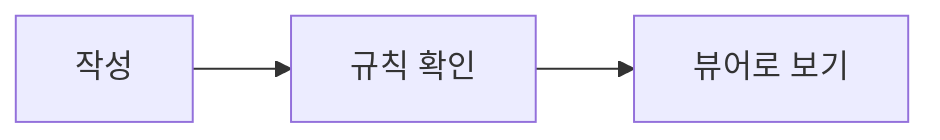

# 📐 보기 좋은 마크다운 작성 규칙

이 규칙대로 쓰면 markcont에서 문서가 한눈에 들어오게 보입니다.
AI에게 문서를 맡길 때는 이 파일을 같이 주고 **"이 규칙대로 다시 써 줘"** 라고 하면 됩니다.

> [!TIP]
> 규칙은 전부 표준 마크다운이라서 GitHub, 노션, Obsidian에서도 깨지지 않습니다.

---

## 1️⃣ 문서 구조

| 규칙 | 이렇게 | 이유 |
|:---|:---|:---|
| 제목(`#`)은 문서에 **하나만** | `# 👋 프로젝트 소개` | 맨 위 제목이 문서 이름이 됩니다 |
| 큰 단락은 `##` + **이모지 하나** | `## 🚀 시작하기` | 목차와 본문에서 단락이 바로 구분됩니다 |
| 작은 단락은 `###`, 이모지 없이 | `### 설치 방법` | 큰 단락과 무게가 달라 보입니다 |
| `##` 단락 사이에는 구분선 `---` | | 화면에서 단락 경계가 분명해집니다 |
| 제목 바로 아래 **한두 줄 요약** | | 읽을지 말지 바로 판단할 수 있습니다 |

### 자주 쓰는 단락 이모지

| 이모지 | 쓰는 곳 | 이모지 | 쓰는 곳 |
|:---:|:---|:---:|:---|
| 👋 | 문서 첫 제목, 인사 | 🚀 | 시작하기, 주요 기능 |
| ✨ | 기본 기능, 특징 | ✅ | 할 일, 확인 목록 |
| 📊 | 표, 비교, 수치 | 💬 | 강조, 안내 |
| 💻 | 코드, 명령어 | 🔗 | 링크, 참고 자료 |
| ❓ | 자주 묻는 질문 | 🎯 | 마무리, 다음 할 일 |
| ⚠️ | 주의 사항 | 📝 | 메모, 변경 기록 |

---

## 2️⃣ 강조는 알림 상자로

중요한 문장은 굵게만 하지 말고 **알림 상자**에 넣습니다. 종류는 다섯 가지만 씁니다.

```markdown
> [!NOTE]
> 알아두면 좋은 정보

> [!TIP]
> 더 잘 쓰는 방법

> [!IMPORTANT]
> 꼭 알아야 하는 핵심

> [!WARNING]
> 실수하기 쉬운 부분

> [!CAUTION]
> 되돌리기 어려운 위험
```

> [!NOTE]
> 알아두면 좋은 정보

> [!WARNING]
> 실수하기 쉬운 부분

- 알림 상자는 한 단락에 **최대 두 개**까지만 씁니다. 많으면 강조가 사라집니다.
- 제목을 직접 정하려면 `> [!TIP] 내가 정한 제목` 처럼 씁니다.
- 접어 두려면 `> [!NOTE]-` (처음에 접힘), `> [!NOTE]+` (처음에 펼침)로 씁니다.

---

## 3️⃣ 글자 꾸미기

| 용도 | 쓰는 법 | 결과 |
|:---|:---|:---|
| 핵심 단어 | `**굵게**` | **굵게** |
| 부드러운 강조 | `*기울임*` | *기울임* |
| 한 곳만 콕 집기 | `==형광펜==` | ==형광펜== |
| 지난 내용 | `~~취소선~~` | ~~취소선~~ |
| 파일 이름, 명령어, 버튼 이름 | `` `코드` `` | `코드` |
| 키보드 단축키 | `<kbd>Ctrl</kbd>+<kbd>S</kbd>` | <kbd>Ctrl</kbd>+<kbd>S</kbd> |

- 형광펜은 한 단락에 **한 번만** 씁니다.
- 한 문장 전체를 굵게 하지 않습니다. 단어만 굵게 합니다.

---

## 4️⃣ 목록과 체크리스트

- 순서가 중요하면 `1.` 번호 목록, 아니면 `-` 글머리 목록을 씁니다.
- 목록 항목은 **한 줄에 한 가지**만 씁니다.
- 할 일은 체크리스트로 씁니다. 뷰어에서 눌러서 체크할 수 있습니다.

```markdown
- [x] 끝난 일
- [ ] 남은 일
```

---

## 5️⃣ 표

- 비교하거나 설정값을 정리할 때는 문장 대신 **표**를 씁니다.
- 둘째 줄의 `:` 위치로 정렬을 정합니다: 왼쪽 `:---`, 가운데 `:---:`, 오른쪽 `---:`
- 짧은 값(예/아니오, 숫자)은 가운데, 설명은 왼쪽으로 맞춥니다.

```markdown
| 설정 항목 | 선택지 | 설명 |
|:---|:---:|:---|
| 테마 | 라이트 / 다크 | 눈이 편한 쪽으로 |
```

---

## 6️⃣ 코드

- 코드 블록에는 **언어 이름을 꼭** 씁니다. 그래야 색이 입혀지고 머리줄에 언어가 표시됩니다.
- 바뀐 내용은 `diff`로 보여줍니다. `-` 줄은 빨강, `+` 줄은 초록으로 표시됩니다.

````markdown
```javascript
console.log("안녕하세요");
```

```diff
- 예전 방식
+ 새 방식
```
````

---

## 7️⃣ 그림, 다이어그램, 수식

| 넣을 것 | 쓰는 법 |
|:---|:---|
| 그림 | `` — 설명은 꼭 씁니다 |
| 흐름도 | ```` ```mermaid ```` 블록에 `flowchart LR` |
| 주고받는 순서 | ```` ```mermaid ```` 블록에 `sequenceDiagram` |
| 문장 속 수식 | `$E = mc^2$` |
| 큰 수식 | `$$ ... $$` 또는 ```` ```math ```` 블록 |
| 화학식 | `$\ce{H2O}$`, `$\ce{2 H2 + O2 -> 2 H2O}$` |
| 유튜브 | 링크만 한 줄에 따로 쓰면 썸네일이 됩니다 |



---

## 8️⃣ 각주와 접는 내용

- 본문을 끊는 부연 설명은 각주로 뺍니다: `설명이 필요한 말[^1]` + 문서 끝에 `[^1]: 설명`
- 자주 묻는 질문처럼 필요할 때만 볼 내용은 접어 둡니다.

```markdown
<details>
<summary>질문을 여기에 씁니다</summary>

답을 여기에 씁니다.

</details>
```

---

## 🎯 한 장 요약

1. `#` 제목은 하나, `##` 단락마다 이모지 하나, 단락 사이에 `---`
2. 강조는 알림 상자(NOTE · TIP · IMPORTANT · WARNING · CAUTION), 단락당 두 개까지
3. 비교와 설정은 표, 할 일은 체크리스트
4. 코드 블록에는 언어 이름, 바뀐 내용은 `diff`
5. 흐름은 mermaid, 수식은 `$`, 화학식은 `\ce{}`
6. 부연 설명은 각주, 질문과 답은 `<details>`
